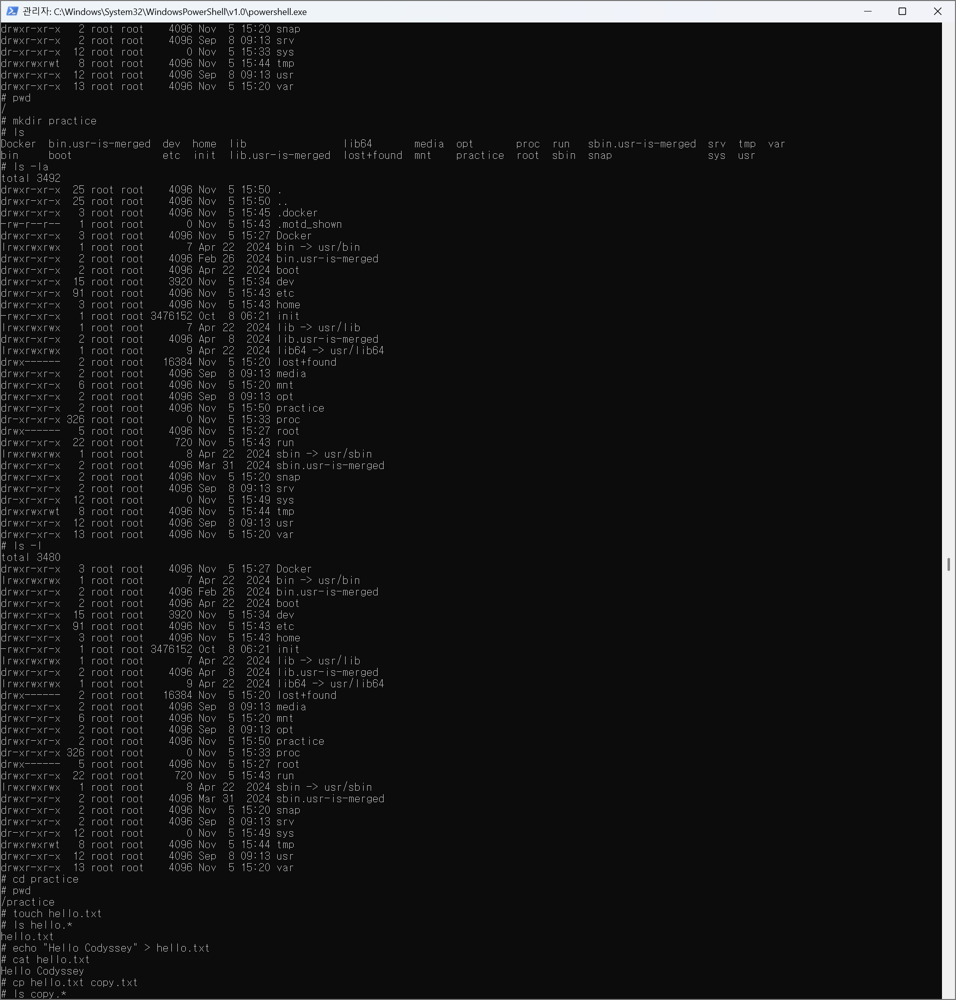
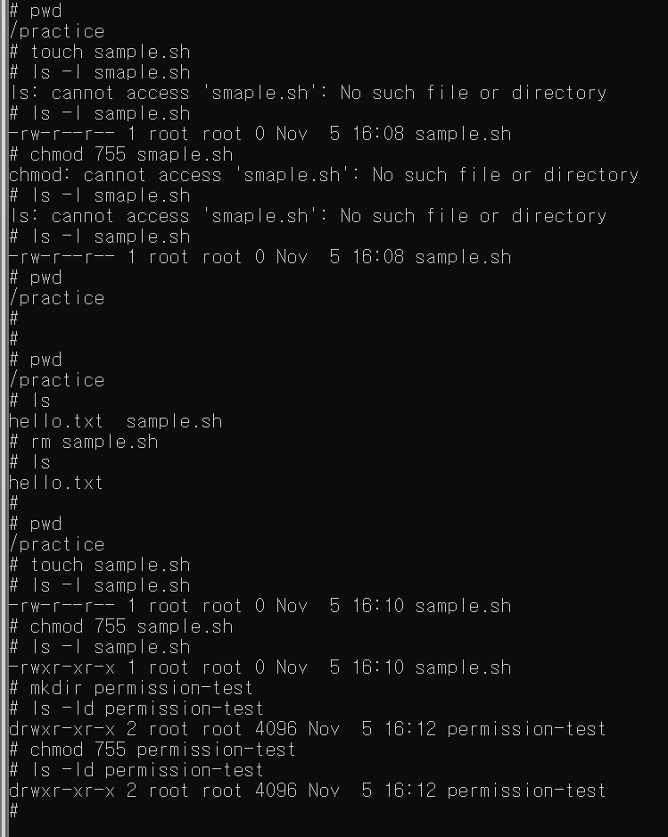
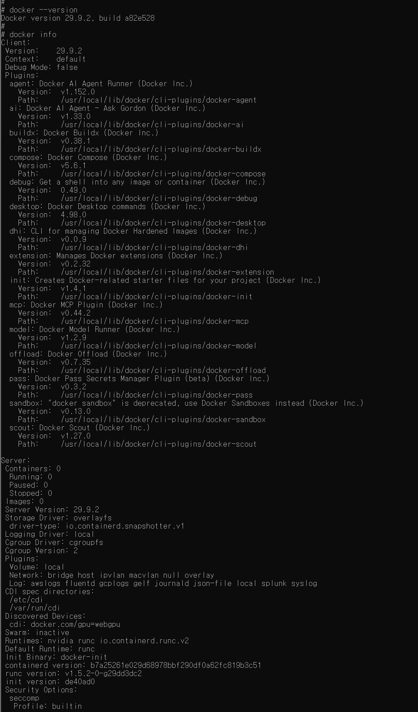
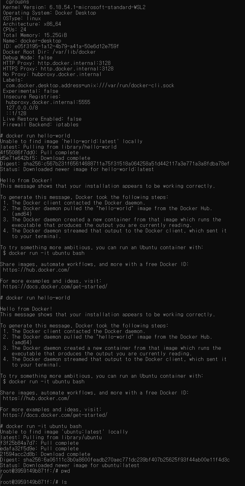
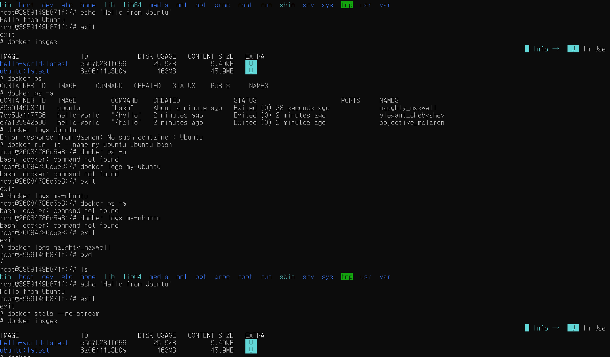
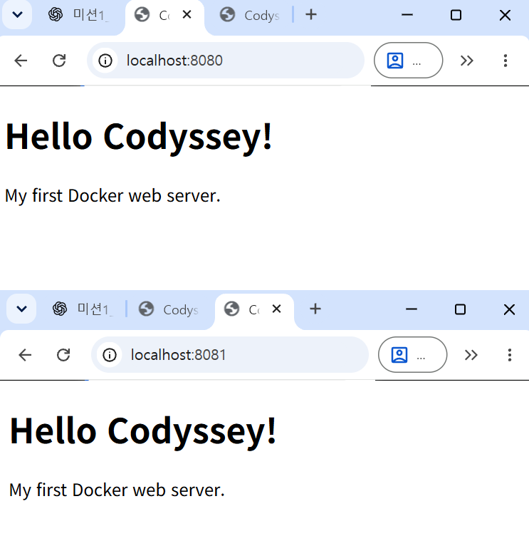
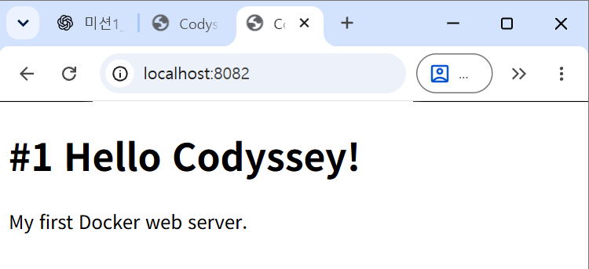
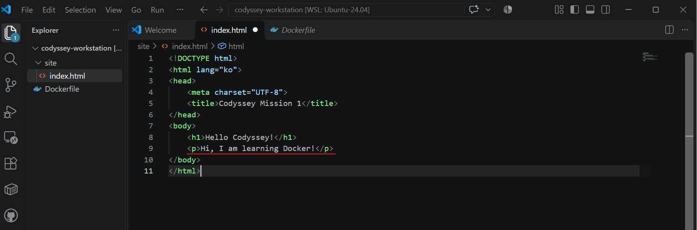
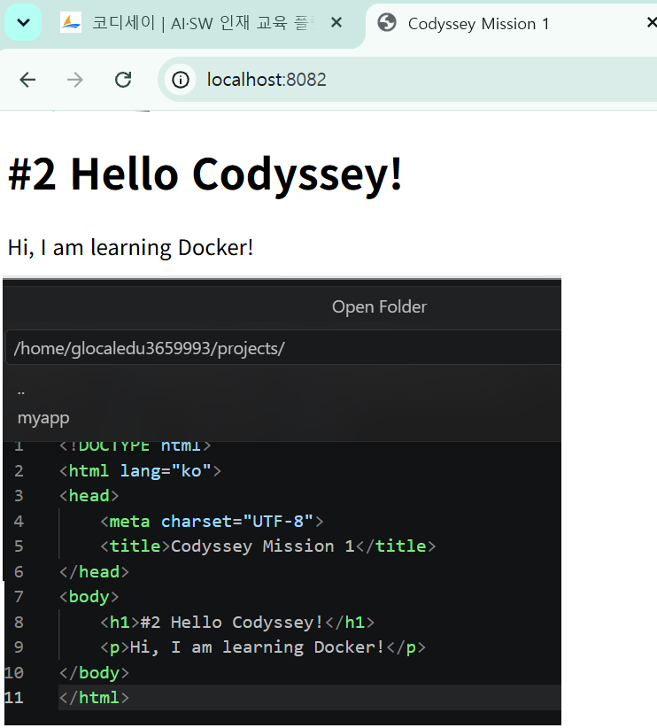
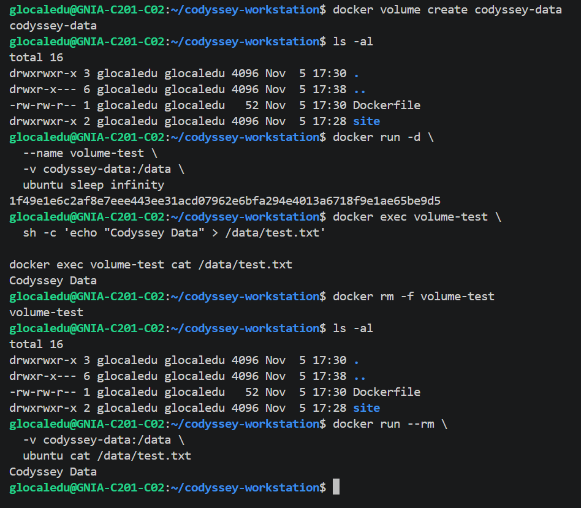

# Codyssey Mission 1 — 내 컴퓨터에 개발자용 '작업실' 꾸미기

## 1. 프로젝트 개요

### 미션 목표

Linux CLI, Docker, Git/GitHub를 이용하여 재현 가능한 개발환경을 구축한다.

**핵심 학습 목표**

- Linux 터미널을 활용한 파일 및 디렉토리 관리
- 파일 접근 권한 이해 및 변경
- Docker 이미지와 컨테이너의 개념 이해
- Dockerfile을 활용한 커스텀 웹 서버 제작
- 포트 매핑을 통한 웹 서버 접속
- Bind Mount와 Docker Volume 실습
- Git/GitHub 기반 코드 관리 및 협업

---

## 2. 개발 환경

| 항목 | 환경 |
|---|---|
| OS | Windows 11 Pro 64bit |
| IDE | Visual Studio Code |
| Shell | [Bash / PowerShell 등] |
| Docker | version 29.9.2, build a82e528 |
| Git | git version 2.43.0 |
| 컨테이너 실행 환경 | [Docker Desktop / OrbStack 등] |

### 환경 확인 명령어

```bash
docker --version
docker info
git --version
```

**실행 결과**
# docker --version
Docker version 29.9.2, build a82e528

# docker info
Client:
 Version:    29.9.2
 Context:    default
 Debug Mode: false
 Plugins:
  agent: Docker AI Agent Runner (Docker Inc.)
    Version:  v1.152.0
    Path:     /usr/local/lib/docker/cli-plugins/docker-agent
  ai: Docker AI Agent - Ask Gordon (Docker Inc.)
    Version:  v1.33.0
    Path:     /usr/local/lib/docker/cli-plugins/docker-ai
  buildx: Docker Buildx (Docker Inc.)
    Version:  v0.38.1
    Path:     /usr/local/lib/docker/cli-plugins/docker-buildx
  compose: Docker Compose (Docker Inc.)
    Version:  v5.6.1
    Path:     /usr/local/lib/docker/cli-plugins/docker-compose
  debug: Get a shell into any image or container (Docker Inc.)
    Version:  0.49.0
    Path:     /usr/local/lib/docker/cli-plugins/docker-debug
  desktop: Docker Desktop commands (Docker Inc.)
    Version:  4.98.0
    Path:     /usr/local/lib/docker/cli-plugins/docker-desktop
  dhi: CLI for managing Docker Hardened Images (Docker Inc.)
    Version:  v0.0.9
    Path:     /usr/local/lib/docker/cli-plugins/docker-dhi
  extension: Manages Docker extensions (Docker Inc.)
    Version:  v0.2.32
    Path:     /usr/local/lib/docker/cli-plugins/docker-extension
  init: Creates Docker-related starter files for your project (Docker Inc.)
    Version:  v1.4.1
    Path:     /usr/local/lib/docker/cli-plugins/docker-init
  mcp: Docker MCP Plugin (Docker Inc.)
    Version:  v0.44.2
    Path:     /usr/local/lib/docker/cli-plugins/docker-mcp
  model: Docker Model Runner (Docker Inc.)
    Version:  v1.2.9
    Path:     /usr/local/lib/docker/cli-plugins/docker-model
  offload: Docker Offload (Docker Inc.)
    Version:  v0.7.35
    Path:     /usr/local/lib/docker/cli-plugins/docker-offload
  pass: Docker Pass Secrets Manager Plugin (beta) (Docker Inc.)
    Version:  v0.3.2
    Path:     /usr/local/lib/docker/cli-plugins/docker-pass
  sandbox: "docker sandbox" is deprecated, use Docker Sandboxes instead (Docker Inc.)
    Version:  v0.13.0
    Path:     /usr/local/lib/docker/cli-plugins/docker-sandbox
  scout: Docker Scout (Docker Inc.)
    Version:  v1.27.0
    Path:     /usr/local/lib/docker/cli-plugins/docker-scout

Server:
 Containers: 0
  Running: 0
  Paused: 0
  Stopped: 0
 Images: 0
 Server Version: 29.9.2
 Storage Driver: overlayfs
  driver-type: io.containerd.snapshotter.v1
 Logging Driver: local
 Cgroup Driver: cgroupfs
 Cgroup Version: 2
 Plugins:
  Volume: local
  Network: bridge host ipvlan macvlan null overlay
  Log: awslogs fluentd gcplogs gelf journald json-file local splunk syslog
 CDI spec directories:
  /etc/cdi
  /var/run/cdi
 Discovered Devices:
  cdi: docker.com/gpu=webgpu
 Swarm: inactive
 Runtimes: io.containerd.runc.v2 nvidia runc
 Default Runtime: runc
 Init Binary: docker-init
 containerd version: b7a25261e029d68978bbf290df0a62fc819b3c51
 runc version: v1.5.2-0-g29dd3dc2
 init version: de40ad0
 Security Options:
  seccomp
   Profile: builtin
  cgroupns
 Kernel Version: 6.18.54.1-microsoft-standard-WSL2
 Operating System: Docker Desktop
 OSType: linux
 Architecture: x86_64
 CPUs: 24
 Total Memory: 15.25GiB
 Name: docker-desktop
 ID: e05f3195-1a12-4b79-a41a-50e6d12e759f
 Docker Root Dir: /var/lib/docker
 Debug Mode: false
 HTTP Proxy: http.docker.internal:3128
 HTTPS Proxy: http.docker.internal:3128
 No Proxy: hubproxy.docker.internal
 Labels:
  com.docker.desktop.address=unix:///var/run/docker-cli.sock
 Experimental: false
 Insecure Registries:
  hubproxy.docker.internal:5555
  127.0.0.0/8
  ::1/128
 Live Restore Enabled: false
 Firewall Backend: iptables

 # git --version
git version 2.43.0
---

## 3. 프로젝트 구조

```text
codyssey-workstation/
├── README.md
├── Dockerfile
├── .gitignore
├── site/
│   └── index.html
├── screenshots/
└── logs/
```

---

## 4. 수행 체크리스트

- [ ] Linux CLI 기본 명령 실습
- [ ] 파일 및 디렉토리 권한 변경
- [ ] Docker 설치 및 엔진 점검
- [ ] hello-world 실행
- [ ] Ubuntu 컨테이너 실행
- [ ] Docker 운영 명령어 실습
- [ ] Dockerfile 작성 및 커스텀 이미지 빌드
- [ ] 포트 매핑 및 웹 서버 접속
- [ ] Bind Mount 변경 반영 검증
- [ ] Docker Volume 영속성 검증
- [ ] Git 설정 및 GitHub 연동
- [ ] 트러블슈팅 2건 이상 기록

---

## 5. Linux CLI 기본 실습

### 실습 목적

터미널에서 파일과 디렉토리를 직접 생성·이동·관리한다.

### 실습 명령어

```bash
pwd
ls -la
mkdir practice
cd practice
touch hello.txt
echo "Hello Codyssey" > hello.txt
cat hello.txt
cp hello.txt copy.txt
mv copy.txt renamed.txt
rm renamed.txt
cd ..
```

### 실습 결과

# pwd
/
# mkdir practice
# ls
Docker  bin.usr-is-merged  dev  home  lib                lib64       media  opt       proc  run   sbin.usr-is-merged  srv  tmp  var
bin     boot               etc  init  lib.usr-is-merged  lost+found  mnt    practice  root  sbin  snap                sys  usr
# ls -la
total 3492
drwxr-xr-x  25 root root    4096 Nov  5 15:50 .
drwxr-xr-x  25 root root    4096 Nov  5 15:50 ..
drwxr-xr-x   3 root root    4096 Nov  5 15:45 .docker
-rw-r--r--   1 root root       0 Nov  5 15:43 .motd_shown
drwxr-xr-x   3 root root    4096 Nov  5 15:27 Docker
lrwxrwxrwx   1 root root       7 Apr 22  2024 bin -> usr/bin
drwxr-xr-x   2 root root    4096 Feb 26  2024 bin.usr-is-merged
drwxr-xr-x   2 root root    4096 Apr 22  2024 boot
drwxr-xr-x  15 root root    3920 Nov  5 15:34 dev
drwxr-xr-x  91 root root    4096 Nov  5 15:43 etc
drwxr-xr-x   3 root root    4096 Nov  5 15:43 home
-rwxr-xr-x   1 root root 3476152 Oct  8 06:21 init
lrwxrwxrwx   1 root root       7 Apr 22  2024 lib -> usr/lib
drwxr-xr-x   2 root root    4096 Apr  8  2024 lib.usr-is-merged
lrwxrwxrwx   1 root root       9 Apr 22  2024 lib64 -> usr/lib64
drwx------   2 root root   16384 Nov  5 15:20 lost+found
drwxr-xr-x   2 root root    4096 Sep  8 09:13 media
drwxr-xr-x   6 root root    4096 Nov  5 15:20 mnt
drwxr-xr-x   2 root root    4096 Sep  8 09:13 opt
drwxr-xr-x   2 root root    4096 Nov  5 15:50 practice
dr-xr-xr-x 326 root root       0 Nov  5 15:33 proc
drwx------   5 root root    4096 Nov  5 15:27 root
drwxr-xr-x  22 root root     720 Nov  5 15:43 run
lrwxrwxrwx   1 root root       8 Apr 22  2024 sbin -> usr/sbin
drwxr-xr-x   2 root root    4096 Mar 31  2024 sbin.usr-is-merged
drwxr-xr-x   2 root root    4096 Nov  5 15:20 snap
drwxr-xr-x   2 root root    4096 Sep  8 09:13 srv
dr-xr-xr-x  12 root root       0 Nov  5 15:49 sys
drwxrwxrwt   8 root root    4096 Nov  5 15:44 tmp
drwxr-xr-x  12 root root    4096 Sep  8 09:13 usr
drwxr-xr-x  13 root root    4096 Nov  5 15:20 var

# cd practice
# pwd
/practice
# touch hello.txt
# ls hello.*
hello.txt
# echo "Hello Codyssey" > hello.txt
# cat hello.txt
Hello Codyssey
# cp hello.txt copy.txt
# ls copy.*
copy.txt
# cat copy.txt
Hello Codyssey
# mv copy.txt renamed.txt
# ls renamed.*
renamed.txt
# rm renamed.txt
# ls
hello.txt
# cp hello.txt copy.txt
# ls
copy.txt  hello.txt
# rm copy.txt && ls
hello.txt
# cd ..
# pwd
/


**증거자료**



### 학습한 내용

- `pwd`: 현재 작업 디렉토리 확인
- `ls -la`: 숨김 파일을 포함한 상세 목록 확인
- `mkdir`: 디렉토리 생성
- `cd`: 디렉토리 이동
- `touch`: 빈 파일 생성
- `cp`: 파일 복사
- `mv`: 파일 이동 및 이름 변경
- `rm`: 파일 삭제

---

## 6. Linux 파일 권한 실습

### 실습 목적

파일과 디렉토리의 접근 권한을 확인하고 변경한다.

### 파일 권한 변경

```bash
touch sample.sh
ls -l sample.sh
chmod 755 sample.sh
ls -l sample.sh
```

### 디렉토리 권한 변경

```bash
mkdir permission-test
ls -ld permission-test
chmod 755 permission-test
ls -ld permission-test
```

### 결과 비교

| 대상 | 변경 전 | 변경 후 |
|---|---|---|
| sample.sh | rw-r--r-- | rwxr-xr-x |
| permission-test | rw-r--r-- | drwxr-xr-x |



### 학습한 내용

- r = 읽기(4)
- w = 쓰기(2)
- x = 실행(1)
- 755 = rwxr-xr-x
- 644 = rw-r--r--

---

## 7. Docker 설치 및 기본 운영

### Docker 상태 확인

```bash
docker --version
docker info
```

### hello-world 실행

```bash
docker run hello-world
```

**실행 결과**

# docker run hello-world
Unable to find image 'hello-world:latest' locally
latest: Pulling from library/hello-world
4f55086f7dd0: Pull complete
d5e71e642bf5: Download complete
Digest: sha256:c567b231f65614688711a75f31518a064258a51d442117a3e771a3a8fdba78ef
Status: Downloaded newer image for hello-world:latest

Hello from Docker!
This message shows that your installation appears to be working correctly.

To generate this message, Docker took the following steps:
 1. The Docker client contacted the Docker daemon.
 2. The Docker daemon pulled the "hello-world" image from the Docker Hub.
    (amd64)
 3. The Docker daemon created a new container from that image which runs the
    executable that produces the output you are currently reading.
 4. The Docker daemon streamed that output to the Docker client, which sent it
    to your terminal.

To try something more ambitious, you can run an Ubuntu container with:
 $ docker run -it ubuntu bash

Share images, automate workflows, and more with a free Docker ID:
 https://hub.docker.com/

For more examples and ideas, visit:
 https://docs.docker.com/get-started/

# docker run hello-world

Hello from Docker!
This message shows that your installation appears to be working correctly.

To generate this message, Docker took the following steps:
 1. The Docker client contacted the Docker daemon.
 2. The Docker daemon pulled the "hello-world" image from the Docker Hub.
    (amd64)
 3. The Docker daemon created a new container from that image which runs the
    executable that produces the output you are currently reading.
 4. The Docker daemon streamed that output to the Docker client, which sent it
    to your terminal.

To try something more ambitious, you can run an Ubuntu container with:
 $ docker run -it ubuntu bash

Share images, automate workflows, and more with a free Docker ID:
 https://hub.docker.com/

For more examples and ideas, visit:
 https://docs.docker.com/get-started/

### Ubuntu 컨테이너 실행

```bash
docker run -it ubuntu bash
```
# docker run -it ubuntu bash
Unable to find image 'ubuntu:latest' locally
latest: Pulling from library/ubuntu
f3f25b84a7d7: Pull complete
edafa32f5d9e: Pull complete
21594acc2d8b: Download complete
Digest: sha256:6a06111c3b0a8600feadb270aec771dc239bf407b25625f93f44ab00e11f4d3c
Status: Downloaded newer image for ubuntu:latest

컨테이너 내부에서 다음 명령을 실행한다.

```bash
pwd
ls
echo "Hello from Ubuntu"
exit
```
root@3959149b871f:/# pwd
/
root@3959149b871f:/# ls
bin  boot  dev  etc  home  lib  lib64  media  mnt  opt  proc  root  run  sbin  srv  sys  tmp  usr  var
root@3959149b871f:/# echo "Hello from Ubuntu"
Hello from Ubuntu
root@3959149b871f:/# exit
exit


### Docker 운영 명령어

```bash
docker images
docker ps
docker ps -a
docker logs [컨테이너명]
docker stats --no-stream
```

# docker images
                                                                                                                                         i Info →   U  In Use
IMAGE                ID             DISK USAGE   CONTENT SIZE   EXTRA
hello-world:latest   c567b231f656       25.9kB         9.49kB    U
ubuntu:latest        6a06111c3b0a        163MB         45.9MB    U
# docker ps
CONTAINER ID   IMAGE     COMMAND   CREATED   STATUS    PORTS     NAMES
# docker ps -a
CONTAINER ID   IMAGE         COMMAND    CREATED              STATUS                      PORTS     NAMES
3959149b871f   ubuntu        "bash"     About a minute ago   Exited (0) 28 seconds ago             naughty_maxwell
7dc5da117786   hello-world   "/hello"   2 minutes ago        Exited (0) 2 minutes ago              elegant_chebyshev
e7a129942b96   hello-world   "/hello"   2 minutes ago        Exited (0) 2 minutes ago              objective_mclaren
# docker logs Ubuntu
Error response from daemon: No such container: Ubuntu
# docker run -it --name my-ubuntu ubuntu bash
root@26084786c5e8:/# docker ps -a
bash: docker: command not found
root@26084786c5e8:/# docker logs my-ubuntu
bash: docker: command not found
root@26084786c5e8:/# exit
exit
# docker logs my-ubuntu
root@26084786c5e8:/# docker ps -a
bash: docker: command not found
root@26084786c5e8:/# docker logs my-ubuntu
bash: docker: command not found
root@26084786c5e8:/# exit
exit
# docker logs naughty_maxwell
root@3959149b871f:/# pwd
/
root@3959149b871f:/# ls
bin  boot  dev  etc  home  lib  lib64  media  mnt  opt  proc  root  run  sbin  srv  sys  tmp  usr  var
root@3959149b871f:/# echo "Hello from Ubuntu"
Hello from Ubuntu
root@3959149b871f:/# exit
exit
# docker stats --no-stream
# docker images
                                                                                                                                         i Info →   U  In Use
IMAGE                ID             DISK USAGE   CONTENT SIZE   EXTRA
hello-world:latest   c567b231f656       25.9kB         9.49kB    U
ubuntu:latest        6a06111c3b0a        163MB         45.9MB    U
# docker





### 학습한 내용

Docker 이미지는 실행환경을 구성하는 템플릿이며, 컨테이너는 이미지를 기반으로 생성되는 실행 인스턴스다.

---

## 8. Dockerfile 커스텀 이미지 제작

### 실습 목표

NGINX 기반 이미지를 활용하여 직접 작성한 HTML 페이지를 제공하는 웹 서버를 구축한다.

### Dockerfile

```dockerfile
FROM nginx:alpine
COPY site/ /usr/share/nginx/html/
```

### 커스텀 포인트

- NGINX Alpine 이미지를 베이스로 사용
- 기본 웹 콘텐츠를 자체 제작 HTML로 교체

### 이미지 빌드

```bash
docker build -t codyssey-web:1.0 .
```

### 컨테이너 실행

```bash
docker run -d -p 8080:80 --name codyssey-web codyssey-web:1.0
```

### 실행 확인

```bash
docker ps
docker logs codyssey-web
```

**실행 결과**

```
glocaledu@GNIA-C201-C02:~/codyssey-workstation$ docker build -t codyssey-web:1.0 .
[+] Building 1.1s (7/7) FINISHED                        docker:default
 => [internal] load build definition from Dockerfile              0.0s
 => => transferring dockerfile: 89B                               0.0s
 => [internal] load metadata for docker.io/library/nginx:alpine   0.0s
 => [internal] load .dockerignore                                 0.0s
 => => transferring context: 2B                                   0.0s
 => [internal] load build context                                 0.1s
 => => transferring context: 275B                                 0.0s
 => [1/2] FROM docker.io/library/nginx:alpine@sha256:785835ea65d  0.6s
 => => resolve docker.io/library/nginx:alpine@sha256:785835ea65d  0.0s
 => => extracting sha256:7b229517ed222597277036d94892173207d01a7  0.1s
 => => extracting sha256:12b85cff06fd7d383d36a9c96503fe049c9d4bf  0.1s
 => => extracting sha256:657023555a2a19dc6036468198bb350d2c7feaa  0.0s
 => => extracting sha256:7cc330898115ce55acccb0cc1e7dd091df4410c  0.0s
 => => extracting sha256:26185d08a3ec318dd85a6c9f2172e714ec13cec  0.0s
 => => extracting sha256:2ec5fb117ffa9a78b15fb6a78745ffc569c8da0  0.0s
 => => extracting sha256:9b0f7dfe35b2711a17f60dadd6d4035dc0cdee1  0.0s
 => => extracting sha256:b9b388a21ecfde6ac80505f23f527146a2129df  0.2s
 => [2/2] COPY site/ /usr/share/nginx/html/                       0.1s
 => exporting to image                                            0.2s
 => => exporting layers                                           0.1s
 => => exporting manifest sha256:c3fdd903217af2957b403a15fed2ad0  0.0s
 => => exporting config sha256:0b39a82d6b1a699640f3fc9e54c448492  0.0s
 => => exporting attestation manifest sha256:980483c43b455e3f2ca  0.0s
 => => exporting manifest list sha256:c1e4d3dedb567542a9e3431b18  0.0s
 => => naming to docker.io/library/codyssey-web:1.0               0.0s
 => => unpacking to docker.io/library/codyssey-web:1.0            0.0s
glocaledu@GNIA-C201-C02:~/codyssey-workstation$ docker run -d -p 8080:80 --name codyssey-web codyssey-web:1.0
96164662be8eda667b836b8fed44f2563b5724f533e31fd5da0cd6690e46292e
glocaledu@GNIA-C201-C02:~/codyssey-workstation$ docker ps
CONTAINER ID   IMAGE              COMMAND                  CREATED       STATUS       PORTS                                     NAMES
96164662be8e   codyssey-web:1.0   "/docker-entrypoint.…"   2 hours ago   Up 2 hours   0.0.0.0:8080->80/tcp, [::]:8080->80/tcp   codyssey-web
glocaledu@GNIA-C201-C02:~/codyssey-workstation$ docker logs codyssey-web
/docker-entrypoint.sh: /docker-entrypoint.d/ is not empty, will attempt to perform configuration
/docker-entrypoint.sh: Looking for shell scripts in /docker-entrypoint.d/
/docker-entrypoint.sh: Launching /docker-entrypoint.d/10-listen-on-ipv6-by-default.sh
10-listen-on-ipv6-by-default.sh: info: Getting the checksum of /etc/nginx/conf.d/default.conf
10-listen-on-ipv6-by-default.sh: info: Enabled listen on IPv6 in /etc/nginx/conf.d/default.conf
/docker-entrypoint.sh: Sourcing /docker-entrypoint.d/15-local-resolvers.envsh
/docker-entrypoint.sh: Launching /docker-entrypoint.d/20-envsubst-on-templates.sh
/docker-entrypoint.sh: Launching /docker-entrypoint.d/30-tune-worker-processes.sh
/docker-entrypoint.sh: Configuration complete; ready for start up
2026/11/05 08:43:10 [notice] 1#1: using the "epoll" event method
2026/11/05 08:43:10 [notice] 1#1: nginx/1.31.8
2026/11/05 08:43:10 [notice] 1#1: built by gcc 15.2.0 (Alpine 15.2.0) 
2026/11/05 08:43:10 [notice] 1#1: OS: Linux 6.18.54.1-microsoft-standard-WSL2
2026/11/05 08:43:10 [notice] 1#1: getrlimit(RLIMIT_NOFILE): 1048576:1048576
2026/11/05 08:43:10 [notice] 1#1: start worker processes
2026/11/05 08:43:10 [notice] 1#1: start worker process 30
2026/11/05 08:43:10 [notice] 1#1: start worker process 31
2026/11/05 08:43:10 [notice] 1#1: start worker process 32
2026/11/05 08:43:10 [notice] 1#1: start worker process 33
2026/11/05 08:43:10 [notice] 1#1: start worker process 34
2026/11/05 08:43:10 [notice] 1#1: start worker process 35
2026/11/05 08:43:10 [notice] 1#1: start worker process 36
2026/11/05 08:43:10 [notice] 1#1: start worker process 37
2026/11/05 08:43:10 [notice] 1#1: start worker process 38
2026/11/05 08:43:10 [notice] 1#1: start worker process 39
2026/11/05 08:43:10 [notice] 1#1: start worker process 40
2026/11/05 08:43:10 [notice] 1#1: start worker process 41
2026/11/05 08:43:10 [notice] 1#1: start worker process 42
2026/11/05 08:43:10 [notice] 1#1: start worker process 43
2026/11/05 08:43:10 [notice] 1#1: start worker process 44
2026/11/05 08:43:10 [notice] 1#1: start worker process 45
2026/11/05 08:43:10 [notice] 1#1: start worker process 46
2026/11/05 08:43:10 [notice] 1#1: start worker process 47
2026/11/05 08:43:10 [notice] 1#1: start worker process 48
2026/11/05 08:43:10 [notice] 1#1: start worker process 49
2026/11/05 08:43:10 [notice] 1#1: start worker process 50
2026/11/05 08:43:10 [notice] 1#1: start worker process 51
2026/11/05 08:43:10 [notice] 1#1: start worker process 52
2026/11/05 08:43:10 [notice] 1#1: start worker process 53
172.17.0.1 - - [05/Nov/2026:08:43:19 +0000] "GET / HTTP/1.1" 200 203 "-" "Mozilla/5.0 (Windows NT 10.0; Win64; x64) AppleWebKit/537.36 (KHTML, like Gecko) Chrome/157.0.0.0 Safari/537.36" "-"
172.17.0.1 - - [05/Nov/2026:08:43:19 +0000] "GET /favicon.ico HTTP/1.1" 404 555 "http://localhost:8080/" "Mozilla/5.0 (Windows NT 10.0; Win64; x64) AppleWebKit/537.36 (KHTML, like Gecko) Chrome/157.0.0.0 Safari/537.36" "-"
2026/11/05 08:43:19 [error] 30#30: *1 open() "/usr/share/nginx/html/favicon.ico" failed (2: No such file or directory), client: 172.17.0.1, server: localhost, request: "GET /favicon.ico HTTP/1.1", host: "localhost:8080", referrer: "http://localhost:8080/"
---

## 9. 포트 매핑 검증

### 실습 목적

호스트 PC의 포트와 컨테이너 내부 포트를 연결하여 웹 서버에 접속한다.

### 실행 명령

```bash
docker run -d -p 8081:80 --name codyssey-web2 codyssey-web:1.0
```

### 접속 확인

- http://localhost:8080
- http://localhost:8081

두 포트에서 웹페이지가 표시되는지 확인한다.



### 학습한 내용

`-p 8080:80`은 호스트 PC의 8080번 포트를 컨테이너의 80번 포트에 연결한다.

---

## 10. Bind Mount 실습

### 실습 목적

호스트 PC의 HTML 파일을 수정했을 때 컨테이너 웹페이지에 변경 내용이 반영되는지 확인한다.

### 실행 명령

```bash
docker run -d -p 8082:80 \
  --name codyssey-bind \
  -v "$(pwd)/site:/usr/share/nginx/html:ro" \
  nginx:alpine
```

### 검증 방법

1. localhost:8082에서 최초 페이지 확인
2. 호스트의 site/index.html 수정
3. 브라우저 새로고침
4. 수정 사항이 반영되는지 확인

**실행 전후 비교**

[실제 변경 전후 내용 작성]
1. 최초 페이지
#1 Hello Codyssey!
My first Docker web server!

2. index.html 수정
<!DOCTYPE html>
<html lang="ko">
<head>
    <meta charset="UTF-8">
    <title>Codyssey Mission 1</title>
</head>
<body>
    <h1>#2 Hello Codyssey!</h1>
    <p>I am learning how to use Docker!</p>
</body>
</html>

3. 브라우저 새로고침
#2 Hello Codyssey!
I am learning how to use Docker!
   




---

## 11. Docker Volume 영속성 검증

### 실습 목적

컨테이너 삭제 후에도 데이터가 유지되는지 확인한다.

① Volume 생성 및 데이터 저장

docker volume create codyssey-data

docker run -d --name volume-test \
  -v codyssey-data:/data \
  ubuntu sleep infinity

docker exec volume-test \
  sh -c 'echo "Codyssey Data" > /data/test.txt'

② 컨테이너 삭제 전 데이터 확인

docker exec volume-test cat /data/test.txt

출력 결과:

Codyssey Data

③ 기존 컨테이너 삭제

docker rm -f volume-test

출력 결과:

volume-test

④ 컨테이너 삭제 후 데이터 확인

docker run --rm \
  -v codyssey-data:/data \
  ubuntu cat /data/test.txt

출력 결과:

Codyssey Data

⑤ 실습 결과 및 학습 내용

기존 컨테이너를 삭제한 후 새로운 컨테이너에 동일한 Docker Volume을 연결하여 데이터 유지 여부를 검증하였다.

Docker Volume은 컨테이너와 별도로 관리되므로 컨테이너를 삭제하더라도 Volume을 삭제하지 않으면 저장된 데이터가 유지된다.

**실제 결과**



### 학습한 내용

Docker Volume은 컨테이너와 독립적으로 관리되므로 컨테이너를 삭제해도 볼륨을 삭제하지 않으면 데이터가 유지된다.

---

## 12. Git 및 GitHub 연동

### Git 설정 확인

```bash
git config --list
```
햣
사용자 정보와 기본 브랜치 설정 상태를 확인한다.

### Git 저장소 생성 및 커밋

```bash
git init
git add .
git commit -m "Complete Codyssey Mission 1"
git status
```

### 원격 저장소 확인

```bash
git remote -v
```

GitHub 저장소를 연결하고 push한 결과를 기록한다.

**GitHub Repository**

https://github.com/glocaledu/codyssey_1-1

[본인 GitHub 저장소 URL]


---

## 13. 트러블슈팅

### 문제 1. WSL2 환경에서 VS Code 실행 오류

**문제 현상**

WSL2 Linux 환경에서 codyssey-workstation 폴더를 생성한 후, VS Code로 프로젝트를 열기 위해 다음 명령어를 실행하였다.

code .

그러나 다음 오류가 발생하면서 VS Code가 실행되지 않았다.

/mnt/c/Program Files/Microsoft VS Code/Code.exe: Invalid argument

**원인 가설**
1. WSL2 Linux에서 Windows에 설치된 VS Code를 실행하는 과정에서 경로 또는 연동 문제가 발생했을 가능성
2. 관리자(root) 계정으로 실행하여 사용자별 VS Code 설정 및 실행 환경이 영향을 주었을 가능성

**확인 과정**

현재 디렉토리와 사용자 계정, Linux 실행 환경을 확인하였다.

pwd
//codyssey-workstation

whoami
root

cat /proc/1/comm
systemd

추가로 Linux 커널 정보를 확인하였다.

uname -r

실행 결과

6.18.54.1-microsoft-standard-WSL2

이를 통해 현재 환경이 Windows의 WSL2 기반 Linux임을 확인하였다.

**해결 방법**
관리자 계정 대신 일반 사용자 glocaledu를 사용하여 개발 실습을 진행하도록 변경하였다.

su - glocaledu

사용자 전환 후 작업 디렉토리에 접근하였다.

cd ~/codyssey-workstation

일반 사용자 계정에서 개발 작업을 계속 진행할 수 있음을 확인하였다.

다만 일반 사용자 환경에서도 code 명령을 찾지 못하는 문제가 추가로 발생하였다.

Command 'code' not found

따라서 VS Code 실행 문제는 사용자 전환만으로 해결되었다고 볼 수 없으며, Windows VS Code와 WSL2의 연결 설정을 별도로 확인해야 한다.


**결과**
상태: 원인 조사 및 사용자 환경 변경 완료 / VS Code 직접 실행은 추가 검증 필요

**학습한 내용**
* WSL2는 Windows에서 Linux 환경을 실행할 수 있도록 지원한다.
* Linux의 root 계정과 일반 사용자 계정은 서로 다른 홈 디렉토리와 사용자 설정을 가진다.
* VS Code 실행 오류는 실행 파일 경로, WSL 연동, 사용자 환경 등의 관점에서 확인해야 한다.
* 오류 해결 여부는 추측이 아니라 명령어 재실행 결과로 검증해야 한다.


### 문제 2. Docker 접근 권한 오류 및 커스텀 이미지 빌드 실패

**문제 현상**

Dockerfile을 이용하여 NGINX 기반 커스텀 이미지를 빌드하는 과정에서 오류가 발생하였다.

docker build -t codyssey-web:1.0 .

발생 오류

ERROR: failed to build: failed to solve:
error getting credentials - err: exit status 1

이후 컨테이너 실행을 시도했으나 빌드가 완료되지 않아 실패하였다.

docker run -d -p 8080:80 \
  --name codyssey-web codyssey-web:1.0

일반 사용자 glocaledu 계정으로 전환하여 Docker 상태를 확인했을 때도 다음 오류가 발생하였다.

permission denied while trying to connect to
the docker API at unix:///var/run/docker.sock

**원인 가설**

root 계정에서 Windows Docker Desktop 인증 프로그램을 호출하는 과정에 문제가 발생했을 가능성

일반 사용자 glocaledu에게 Docker 소켓 접근 권한이 없는 문제

Docker 이미지 빌드가 실패하여 실행에 필요한 이미지가 생성되지 않은 문제

**확인 과정**

일반 사용자로 전환한 후 Docker 상태를 확인하였다.

su - glocaledu
docker info

실행 결과

Client:
 Version: 29.9.2

Server:
permission denied while trying to connect to
the docker API at unix:///var/run/docker.sock

NGINX 이미지 다운로드도 시도하였다.

docker pull nginx:alpine

실행 결과

permission denied while trying to connect to
the docker API at unix:///var/run/docker.sock

Docker CLI는 정상 설치되어 있었으나 일반 사용자에게 Docker 엔진 접근 권한이 없는 것으로 판단하였다.

**해결 방법**

① Docker 그룹에 사용자 추가

root 계정으로 돌아간 후 glocaledu 사용자를 Docker 그룹에 추가하였다.

sudo usermod -aG docker glocaledu

그룹 변경 명령을 실행하였다.

newgrp docker
groups

실행 결과

docker root

이 결과는 당시 root 세션에 Docker 그룹이 적용되었음을 의미한다.

② Docker 엔진 연결 확인

docker info

주요 실행 결과

Server:
 Containers: 4
  Running: 0
  Paused: 0
  Stopped: 4
 Images: 2
 Server Version: 29.9.2
 Storage Driver: overlayfs
 Operating System: Docker Desktop
 Architecture: x86_64
 CPUs: 24
 Total Memory: 15.25GiB

Docker Server 정보가 정상 출력되는 것을 확인하였다.

③ 일반 사용자로 다시 접속

su - glocaledu
cd ~/codyssey-workstation

④ NGINX 이미지 다운로드 성공

docker pull nginx:alpine

실행 결과

alpine: Pulling from library/nginx

Pull complete
Pull complete
Pull complete

Status: Downloaded newer image for nginx:alpine
docker.io/library/nginx:alpine

Docker 소켓 접근 권한 문제가 해결되어 일반 사용자 계정에서도 이미지 다운로드가 정상적으로 진행되었다.

⑤ 커스텀 Docker 이미지 빌드

작성한 Dockerfile:

FROM nginx:alpine
COPY site/ /usr/share/nginx/html/

이미지 빌드 명령어:

docker build -t codyssey-web:1.0 .

실행 결과

[+] Building 1.1s (7/7) FINISHED

[internal] load build definition from Dockerfile
[internal] load metadata for docker.io/library/nginx:alpine
[internal] load build context
[1/2] FROM docker.io/library/nginx:alpine
[2/2] COPY site/ /usr/share/nginx/html/
exporting to image
naming to docker.io/library/codyssey-web:1.0

커스텀 이미지 codyssey-web:1.0이 정상적으로 생성되었다.

⑥ Docker 컨테이너 실행

docker run -d -p 8080:80 \
  --name codyssey-web codyssey-web:1.0

실행 결과

96164662be8eda667b836b8fed44f2563b5724f533e31fd5da0cd6690e46292e

컨테이너가 생성되어 백그라운드 실행을 시작하였다.

**결과**

Windows 웹 브라우저에서 다음 주소로 접속하였다.

http://localhost:8080/

브라우저 출력 결과

Hello Codyssey!
My first Docker web server.

호스트 PC의 8080번 포트와 NGINX 컨테이너의 80번 포트가 정상적으로 연결되어 웹페이지가 표시되는 것을 확인하였다.

---

## 14. 핵심 개념 정리

| 개념 | 학습 내용 |
|---|---|
| 절대경로 | 루트부터 시작하는 전체 경로 |
| 상대경로 | 현재 위치를 기준으로 하는 경로 |
| 755 권한 | 소유자 rwx, 그룹 r-x, 기타 r-x |
| Docker Image | 컨테이너 실행을 위한 템플릿 |
| Docker Container | 이미지로부터 생성되는 실행 인스턴스 |
| Port Mapping | 호스트와 컨테이너의 포트 연결 |
| Bind Mount | 호스트 파일·폴더를 컨테이너에 연결 |
| Docker Volume | Docker가 관리하는 영속 데이터 저장공간 |
| Git | 로컬 버전관리 도구 |
| GitHub | 원격 저장소 및 협업 플랫폼 |

---

## 15. 학습 회고

### 새롭게 배운 점

[직접 경험하고 이해한 내용을 작성]

### 가장 어려웠던 부분

[어려웠던 개념이나 실습 내용]

### 문제를 해결하며 알게 된 점

[진단과 해결 과정에서 배운 내용]

### 앞으로 적용하고 싶은 분야

[향후 개발 프로젝트에 활용할 방법]

---

## 16. 최종 검증

- [ ] 모든 필수 기능 실행 완료
- [ ] README에 명령어와 실제 출력 결과 기록
- [ ] 포트 매핑 접속 스크린샷 확인
- [ ] Bind Mount 전후 변경 증거 확인
- [ ] Volume 데이터 유지 검증
- [ ] GitHub 원격 저장소 업로드 확인
- [ ] 트러블슈팅 2건 이상 기록
- [ ] 토큰·비밀번호 등 민감정보 노출 여부 확인
- [ ] 다른 사람이 README를 보고 실습을 재현할 수 있는지 확인

**최종 결과:** [검증 후 작성]
