# 내 컴퓨터에 개발자용 '작업실' 꾸미기

> **Codyssey 입학연수 Mission 1** · 터미널(CLI) + Docker + Git/GitHub 개발 환경 구축
> "내 PC에서만 되는 코드"가 아니라, **누구나 같은 순서로 따라 하면 같은 결과가 나오는 환경**을 직접 만들고 검증한 프로젝트입니다.

**GitHub 저장소:** [glocaledu/codyssey_1-1](https://github.com/glocaledu/codyssey_1-1)

## 목차

1. [프로젝트 개요](#1-프로젝트-개요)
2. [5분 만에 이해하는 쉬운 설명 (ELI5)](#2-5분-만에-이해하는-쉬운-설명-eli5)
3. [실행 환경](#3-실행-환경)
4. [수행 체크리스트](#4-수행-체크리스트)
5. [재현 방법 (따라 하기)](#5-재현-방법-따라-하기)
6. [실행 및 증빙 스크린샷](#6-실행-및-증빙-스크린샷)
7. [터미널 조작 · 권한 실습](#7-터미널-조작--권한-실습)
8. [Docker 실습 로그](#8-docker-실습-로그)
9. [전체 구조와 데이터 흐름](#9-전체-구조와-데이터-흐름)
10. [Git 설정](#10-git-설정)
11. [진행 과정](#11-진행-과정)
12. [에러 해결 기록](#12-에러-해결-기록)
13. [배운 점과 향후 계획](#13-배운-점과-향후-계획)
14. [보안 · 개인정보](#14-보안--개인정보)
15. [제출 정보](#15-제출-정보)

---

## 1. 프로젝트 개요

터미널(CLI), Docker, Git/GitHub를 직접 세팅하고, 그 과정을 **명령어와 출력 결과(로그)** 로 남긴 미션입니다. 로그에서 `$` 는 입력한 명령어, 그 아래 줄은 출력입니다.

| 항목 | 내용 |
| --- | --- |
| 프로젝트 | 내 컴퓨터에 개발자용 '작업실' 꾸미기 |
| 학습 과정 | Codyssey 입학연수 Mission 1 |
| 개발 환경 | Windows + WSL2 (Ubuntu 24.04), VS Code |
| 주요 기술 | 터미널(bash), Docker, Dockerfile, Git / GitHub |
| 직접 만든 것 | `Dockerfile` (nginx:alpine 기반 커스텀 이미지), `site/index.html` |
| 외부 라이브러리 | 없음 |
| 작업 방식 | 모든 명령을 터미널(CLI)에서 수행 |

### 프로젝트 목표

단순히 명령어를 따라 치는 것을 넘어 다음 질문에 **내 말로 설명할 수 있는 것**을 목표로 했습니다.

- 절대경로와 상대경로는 무엇이 다르고, 파일 권한(`755`, `644`)은 어떻게 읽는가?
- Docker 이미지와 컨테이너는 무엇이 다른가?
- 포트 매핑(`-p 8080:80`)은 왜 필요한가?
- 컨테이너를 지워도 데이터가 남으려면 어떻게 해야 하는가? (바인드 마운트 vs 볼륨)
- Git과 GitHub는 각각 어떤 역할을 하는가?

## 2. 5분 만에 이해하는 쉬운 설명 (ELI5)

> 개발을 처음 접하는 평가자도 이해할 수 있도록, 이 미션의 핵심 개념을 일상 비유로 정리했습니다.

| 용어 | 쉬운 비유 | 이 미션에서 한 일 |
| --- | --- | --- |
| **터미널(CLI)** | 마우스 대신 **글자로 컴퓨터에게 부탁**하는 창구 | `ls`, `cd`, `mkdir`로 폴더·파일을 만들고 옮김 |
| **절대경로 / 상대경로** | "서울시 중구 ○○로 12번지"(절대) vs "지금 서 있는 곳에서 두 칸 옆"(상대) | `/home/daniel/...` 와 `../docs/note.txt` 비교 |
| **파일 권한** | 집 열쇠 규칙. **누가(주인·가족·손님) 읽고·쓰고·실행**할 수 있는지 | `chmod 755`, `644`, `600`으로 바꿔 보기 |
| **Docker 이미지** | **레시피(설계도)**. 읽기만 가능, 바뀌지 않음 | `Dockerfile`로 `my-web:1.0` 이미지 제작 |
| **Docker 컨테이너** | 레시피로 **실제로 만든 요리**. 여러 개 만들 수 있음 | 같은 이미지로 컨테이너 3개 실행 |
| **Dockerfile** | 레시피를 적어 둔 **조리 순서서** | `nginx:alpine` 위에 내 웹페이지를 얹음 |
| **포트 매핑** | 건물의 **호실 번호**. 밖에서 "8080호"로 오면 안쪽 "80호 방"으로 연결 | `-p 8080:80`, `-p 8081:80` |
| **바인드 마운트** | 내 책상 서랍과 컨테이너를 **유리창으로 직접 연결**. 내가 고치면 바로 보임 | 호스트 `site/` 수정 → 재빌드 없이 v2 반영 |
| **볼륨** | 컨테이너와 별개로 보관되는 **금고**. 컨테이너를 버려도 남음 | `mydata` 볼륨에 `hello.txt` 저장 후 재확인 |
| **Git** | 내 컴퓨터 안의 **저장 기록 노트**(언제 무엇을 바꿨는지) | 사용자 정보·기본 브랜치 설정 |
| **GitHub** | 그 노트를 인터넷에 **백업·공유**하는 서비스 | 저장소 `glocaledu/codyssey_1-1`에 연동 |

**한 줄 요약:** *레시피(이미지)로 요리(컨테이너)를 만들고, 호실 번호(포트)로 손님을 안내하며, 금고(볼륨)에 소중한 것을 보관했습니다.*

## 3. 실행 환경

| 항목 | 값 |
| --- | --- |
| OS | Windows + WSL2 (Ubuntu 24.04.1 LTS, x86_64) |
| Shell | GNU bash 5.3.9 |
| Docker | Docker Desktop (WSL2 Engine), Docker 29.8.0 (Compose v5.5.1 포함) |
| Git | 2.53.0 |
| 터미널 | Windows Terminal + WSL2 Ubuntu |
| 작업 폴더 | `~/projects/myapp/codyssey_1-1` (`HOME=/home/daniel`) |

WSL 배포판 상태 (Windows PowerShell):

```
PS C:\Windows\system32> wsl -l -v
  NAME              STATE           VERSION
* Ubuntu            Running         2
  docker-desktop    Running         2
```

버전 확인 명령:

```
TODO(붙여넣기): lsb_release -a / bash --version / docker --version / git --version 출력
```

> **재현 시 주의:** 이 환경은 Windows + Docker Desktop(WSL2) 기준입니다. Docker Desktop의 **Settings → Resources → WSL Integration** 에서 사용하는 Ubuntu 배포판이 켜져 있어야 WSL 터미널에서 `docker` 명령이 동작합니다. ([12-1](#12-1-wsl-에서-docker-명령을-찾지-못함) 참고)

## 4. 수행 체크리스트

- [ ] 터미널 기본 조작 · 권한 변경 실습 (7장, `terminal.log` 붙여넣기 후 체크)
- [ ] Docker 설치/점검 (`docker --version`, `docker info` 출력 붙여넣기 후 체크)
- [x] `hello-world` 실행
- [x] `ubuntu` 컨테이너 실행, 내부 진입 후 `ls` · `echo` 수행
- [x] `run` / `exec` / `attach` 차이 관찰
- [x] 직접 작성한 Dockerfile로 커스텀 이미지 빌드·실행 (nginx:alpine 기반)
- [ ] 포트 매핑 접속 2회 (8080 확인 완료, 8081 `curl` 출력과 브라우저 화면 추가 후 체크)
- [x] 바인드 마운트 반영 (호스트 수정 → 재빌드 없이 반영)
- [x] 볼륨 영속성 (컨테이너 삭제 전/후 + 볼륨 없는 대조군)
- [x] 컨테이너 운영 명령 (`images`, `ps -a`, `logs`, `stats`, `stop`/`start`)
- [ ] Git 사용자 정보 · 기본 브랜치 설정 (최종 `git config --list` 붙여넣기 후 체크)
- [ ] VS Code GitHub 로그인 · 저장소 연동 증거
- [ ] (보너스) Compose / SSH 키 — 미수행
- [x] 민감정보(토큰 · 비밀번호) 미포함 확인

## 5. 재현 방법 (따라 하기)

### 5-1. 사전 준비

Docker Desktop을 켜고 WSL Integration에서 Ubuntu를 활성화한 뒤, WSL 터미널에서 확인합니다.

```
docker --version
docker info
```

> `docker info` 에 **Server** 항목이 나오면 Docker Desktop이 켜져 있는 것입니다.

### 5-2. 저장소 복제 및 이미지 빌드

```
# GitHub 저장소 복제
git clone https://github.com/glocaledu/codyssey_1-1.git
cd codyssey_1-1

# 이미지 빌드 (site/index.html 은 'v1 (이미지에 포함된 기본 페이지)')
docker build -t my-web:1.0 .
```

### 5-3. 포트 매핑 2회

```
docker run -d -p 8080:80 --name my-web-8080 my-web:1.0
docker run -d -p 8081:80 -e APP_ENV=staging --name my-web-8081 my-web:1.0
curl -i http://localhost:8080
curl -i http://localhost:8081
```

### 5-4. 바인드 마운트: 호스트 파일만 고쳐서 반영되는지 확인

```
docker run -d -p 8082:80 -v "$PWD/site:/usr/share/nginx/html" --name my-web-bind my-web:1.0
curl http://localhost:8082
echo '<h1>Codyssey Mission1</h1><p>version: v2 (호스트에서 수정, 재빌드 없음)</p>' > site/index.html
curl http://localhost:8082   # v2 로 바뀜
curl http://localhost:8080   # v1 그대로 (마운트 안 함)
```

### 5-5. 볼륨 영속성

```
docker volume create mydata
docker run -d --name vol-test -v mydata:/data my-web:1.0
docker exec vol-test sh -c 'echo hi > /data/hello.txt'
docker rm -f vol-test
docker run -d --name vol-test2 -v mydata:/data my-web:1.0
docker exec vol-test2 cat /data/hello.txt   # hi
```

## 6. 실행 및 증빙 스크린샷

> 아래 이미지는 저장소의 `screenshots/` 폴더를 참조합니다. README와 이미지가 함께 GitHub에 올라가 있어야 정상 표시됩니다.

### 6-1. 터미널(CLI) 기본 조작

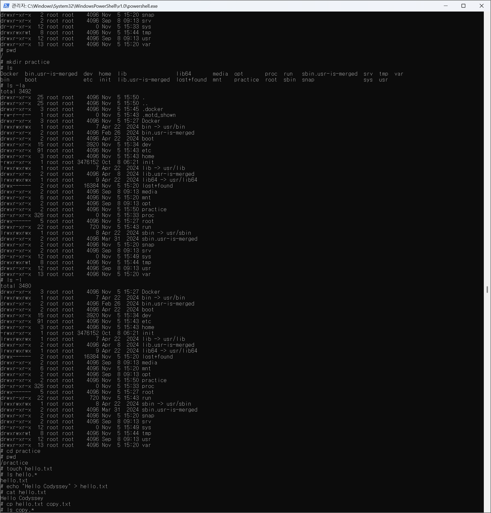

### 6-2. 파일 권한 변경

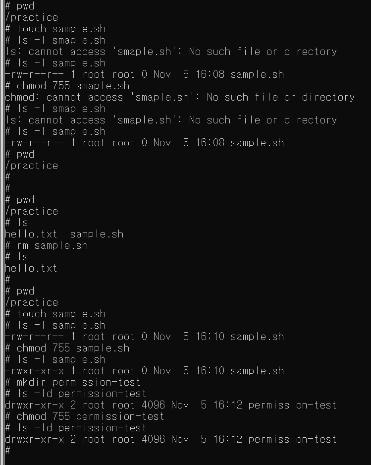

### 6-3. Docker 실습 (설치 확인 · 컨테이너 실행)

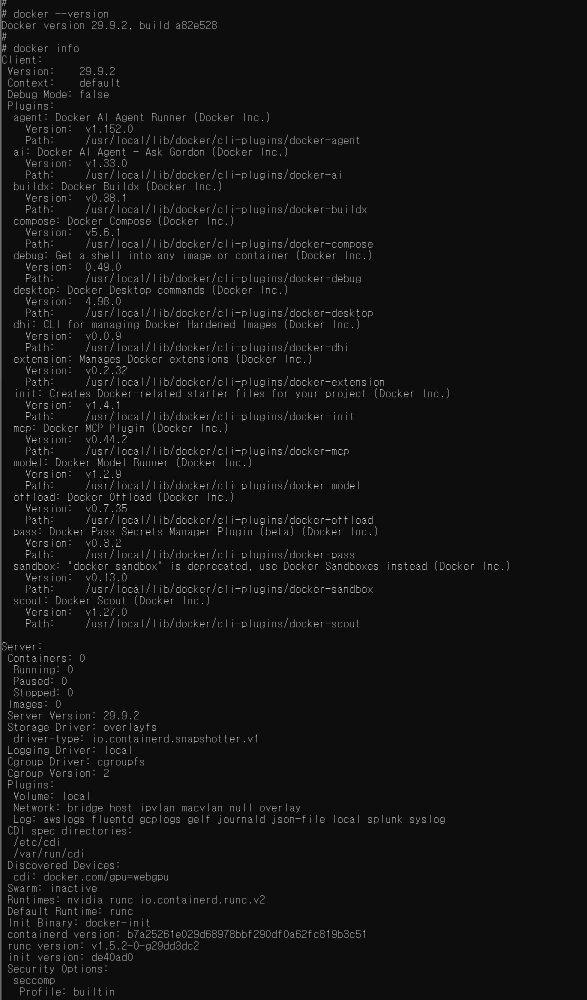

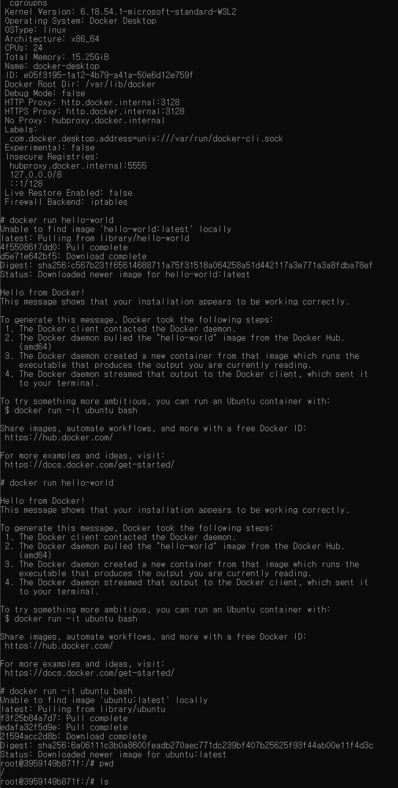

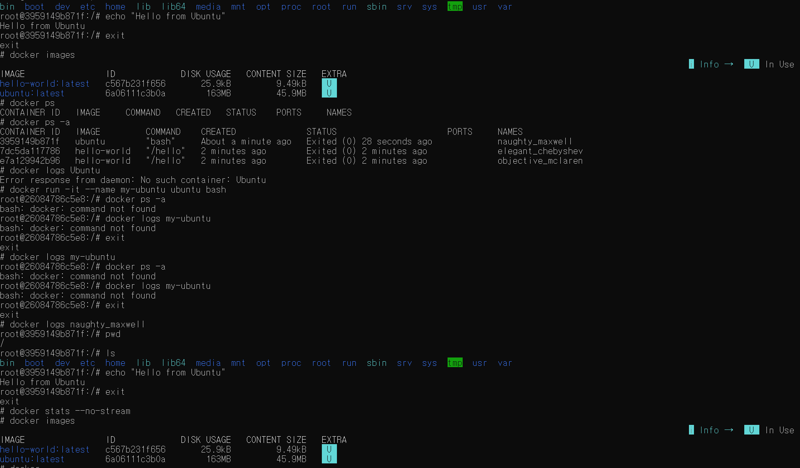

### 6-4. 웹 브라우저 접속 (포트 매핑)

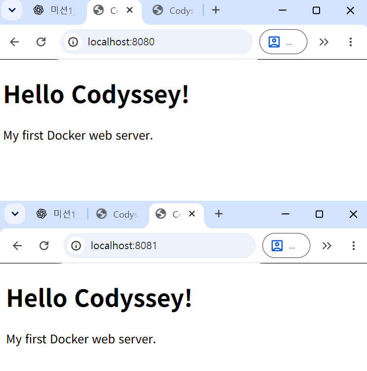

### 6-5. 바인드 마운트

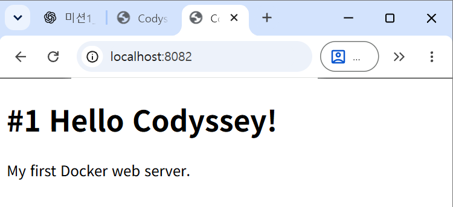

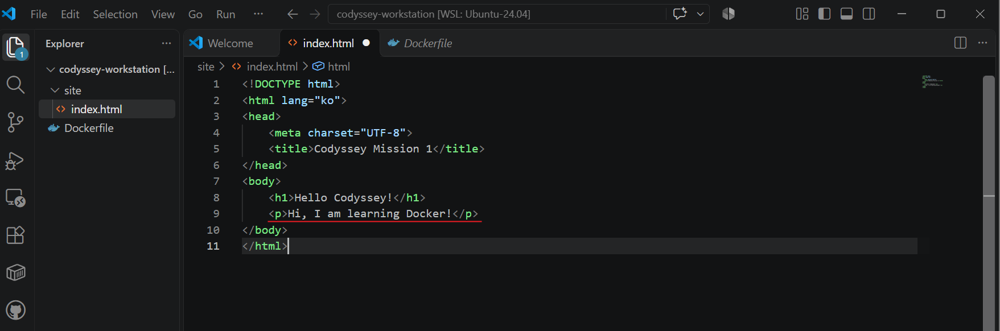

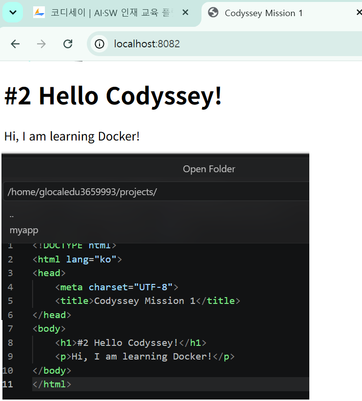

### 6-6. 볼륨 영속성

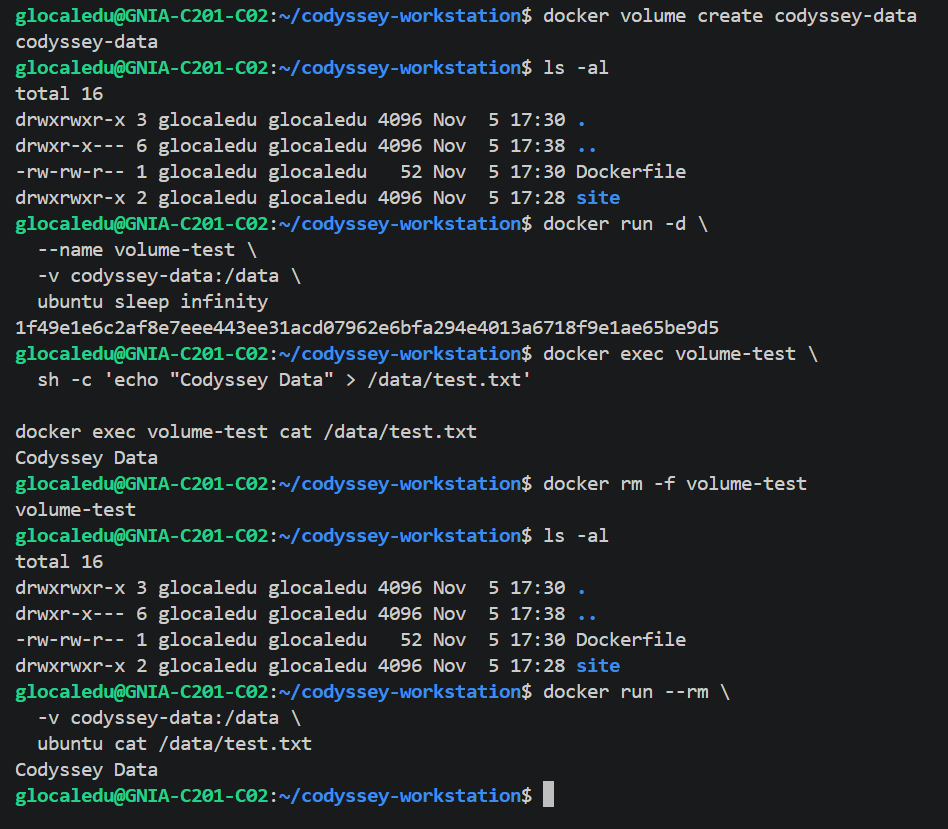

### 6-7. Git 상태 확인

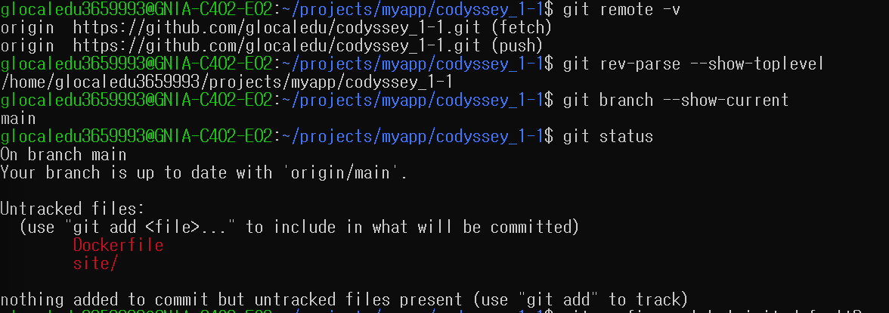

### 6-8. GitHub 저장소

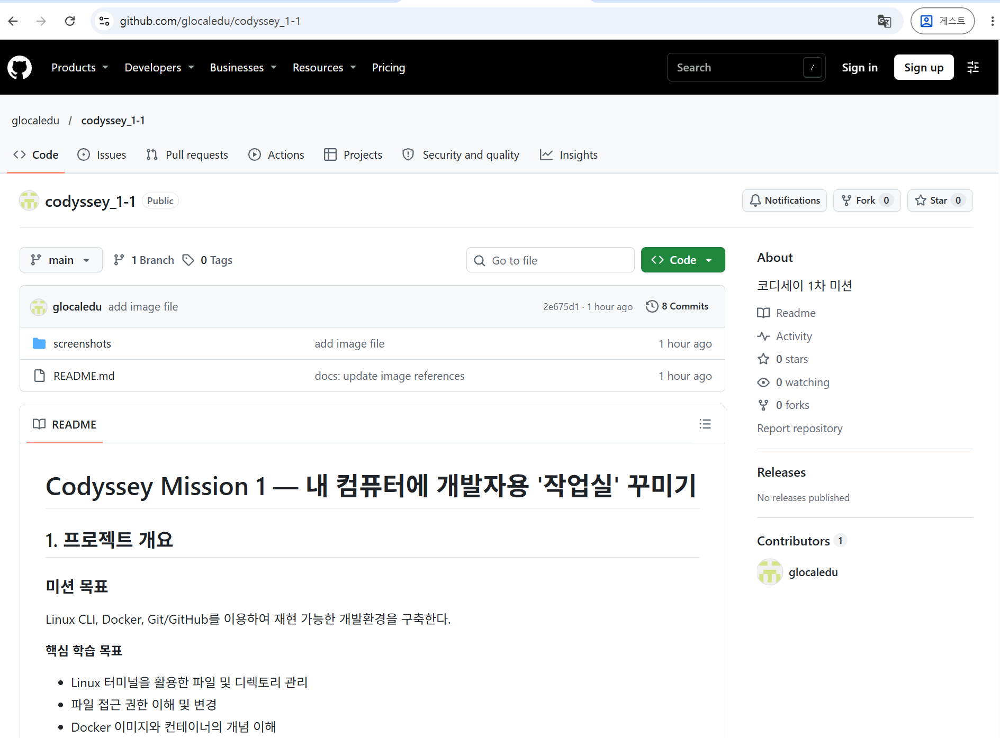

```
TODO(선택): 8081 접속 브라우저 화면, VS Code GitHub 로그인·저장소 연동 화면이 있다면 screenshots/ 에 추가 후 위와 같이 링크 (토큰·인증 코드는 가리고 캡처)
```

## 7. 터미널 조작 · 권한 실습

> **쉬운 설명:** 컴퓨터의 "폴더와 파일"을 마우스 대신 글자로 다루는 연습입니다. 파일마다 **누가 읽고·쓰고·실행할 수 있는지** 열쇠 규칙(권한)도 바꿔 봤습니다.

`~/projects/myapp/codyssey_1-1/practice` 에서 실습했습니다. 현재 위치(`pwd`), 목록(`ls -la`, 숨김 파일 포함), 이동, 생성, 복사, 이동/이름변경, 삭제, 내용 확인(`cat`), 빈 파일 생성(`touch`), 권한 변경(`chmod`, 파일 1개 + 디렉토리 1개)을 수행했습니다.

<details>
<summary>실행한 스크립트 (practice/practice.sh) 펼치기</summary>

```
PS4='$ '; set -x
pwd
mkdir -p docs
touch empty.txt .hidden_file
echo "hello codyssey" > docs/note.txt
ls -la
cat docs/note.txt
cp docs/note.txt docs/note_copy.txt
mv docs/note_copy.txt docs/renamed.txt
ls -la docs
rm docs/renamed.txt
ls docs
cd docs
pwd
cat ~/projects/myapp/codyssey_1-1/practice/docs/note.txt
cat note.txt
cat ../docs/note.txt
cd ..
ls -l docs/note.txt
chmod 600 docs/note.txt
ls -l docs/note.txt
chmod 755 docs/note.txt
ls -l docs/note.txt
chmod 644 docs/note.txt
ls -l docs/note.txt
ls -ld docs
chmod 700 docs
ls -ld docs
chmod 755 docs
ls -ld docs
```

</details>

실행 결과 (`bash practice.sh 2>&1 | tee ../logs/terminal.log`):

```
TODO(붙여넣기): logs/terminal.log 출력
```

### 관찰 정리

- **절대경로**는 `/`(루트)부터 시작해서 어디서 실행해도 같은 곳을 가리킵니다. (예: `/home/daniel/projects/myapp/codyssey_1-1/practice/docs/note.txt`) **상대경로**는 지금 서 있는 위치(`pwd`)가 기준이라 `note.txt`, `../docs/note.txt` 처럼 위치가 바뀌면 의미도 달라집니다.
- 권한은 **r=4, w=2, x=1** 의 합입니다.

| 숫자 | 표시 | 뜻 |
| --- | --- | --- |
| `755` | `rwxr-xr-x` | 주인은 모두 가능, 나머지는 읽기·실행만 |
| `644` | `rw-r--r--` | 주인은 읽기·쓰기, 나머지는 읽기만 |
| `600` | `rw-------` | 주인만 읽기·쓰기 |
| `700` | `rwx------` | 주인만 모두 가능 |

- 디렉토리의 `x` 는 "그 안으로 들어가(`cd`) 이름으로 접근할 수 있는 권한"이라, 디렉토리는 보통 `755` 입니다.

## 8. Docker 실습 로그

> 아래 긴 출력은 `<details>` 를 눌러 펼쳐 볼 수 있고, 전체 원본은 저장소의 `logs/` 폴더에 있습니다.

### 8-1. 설치 · 데몬 점검

```
TODO(붙여넣기): docker --version / docker info / docker version(Client와 Server 모두 나오는지) 출력
```

### 8-2. 직접 작성한 Dockerfile · 커스텀 이미지

> **쉬운 설명:** 이미 만들어진 "웹 서버 도시락(nginx:alpine)"을 사 와서, 속 반찬(내 웹페이지)만 바꿔 담은 **나만의 도시락 레시피**를 썼습니다.

과제의 (A) 웹 서버 베이스 이미지 활용 방식을 선택했습니다. 베이스는 `nginx:alpine`(공식 nginx의 경량 Alpine 버전)이고, 정적 콘텐츠와 설정만 바꿨습니다.

```
codyssey_1-1/
├── Dockerfile
└── site/
    └── index.html
```

**`site/index.html`** (빌드 시점의 내용)

```html
<h1>Codyssey Mission1</h1>
<p>version: v1 (이미지에 포함된 기본 페이지)</p>
```

**`Dockerfile`**

```dockerfile
FROM nginx:alpine
LABEL org.opencontainers.image.title="my-custom-nginx"
ENV APP_ENV=dev
COPY site/ /usr/share/nginx/html/
EXPOSE 80
HEALTHCHECK --interval=10s --timeout=3s --retries=3 \
  CMD wget -qO- http://localhost/ >/dev/null || exit 1
```

| 줄 | 하는 일 | 쉬운 설명 |
| --- | --- | --- |
| `FROM nginx:alpine` | 웹 서버가 이미 설치된 가벼운 베이스를 재사용 | 밑반찬이 갖춰진 도시락통을 빌려 씀 |
| `LABEL` | 이미지 이름 등 메타데이터 표기 | 도시락통에 이름표 붙이기 |
| `ENV APP_ENV=dev` | 설정값 기본 지정, 실행 시 `-e` 로 덮어쓰기 가능 | "오늘은 개발용" 메모. 필요하면 바꿔 쓸 수 있음 |
| `COPY site/ ...` | nginx 기본 페이지를 내 페이지로 교체 | 반찬을 내가 만든 것으로 교체 |
| `EXPOSE 80` | 컨테이너가 80번 포트를 쓴다고 문서화 | 방 번호를 안내판에 적어 둠 (실제 개방은 `-p`) |
| `HEALTHCHECK` | 10초마다 정상 응답하는지 확인 | 10초마다 "잘 계세요?" 안부 묻기 |

<details>
<summary>빌드 명령과 출력 펼치기 (nginx:alpine 처음 내려받는 로그, 일부 생략)</summary>

```
$ docker build -t my-web:1.0 .
[+] Building 6.7s (7/7) FINISHED                                                    docker:default
 => [internal] load build definition from Dockerfile                                          0.0s
 => => transferring dockerfile: 278B                                                          0.0s
 => [internal] load metadata for docker.io/library/nginx:alpine                               2.4s
 => [internal] load .dockerignore                                                             0.0s
 => [internal] load build context                                                             0.1s
 => => transferring context: 157B                                                             0.0s
 => [1/2] FROM docker.io/library/nginx:alpine@sha256:713fc2ebfd92e8217db451477182ee91944b123  3.5s
 => => ... (레이어 다운로드·압축 해제 줄 생략) ...
 => [2/2] COPY site/ /usr/share/nginx/html/                                                   0.2s
 => exporting to image                                                                        0.3s
 => => naming to docker.io/library/my-web:1.0                                                 0.0s
```

</details>

### 8-3. 포트 매핑 접속 (2회)

> **쉬운 설명:** 컨테이너 안쪽 방 번호는 둘 다 80번이지만, 건물 밖에서 부르는 호실 번호를 **8080 / 8081**로 다르게 붙였습니다. 같은 레시피로 만든 요리 두 접시를 다른 테이블 번호로 내보낸 셈입니다. 8081 컨테이너는 `-e APP_ENV=staging` 으로 Dockerfile의 기본값(`dev`)을 덮어썼습니다.

```
docker run -d -p 8080:80 --name my-web-8080 my-web:1.0
docker run -d -p 8081:80 -e APP_ENV=staging --name my-web-8081 my-web:1.0
```

**1회차: 8080 접속**

```
$ curl -i http://localhost:8080
HTTP/1.1 200 OK
Server: nginx/1.31.8
Date: Mon, 09 Nov 2026 08:28:55 GMT
Content-Type: text/html
Content-Length: 87
Last-Modified: Mon, 09 Nov 2026 08:24:39 GMT
Connection: keep-alive
ETag: "6af18347-57"
Accept-Ranges: bytes

<h1>Codyssey Mission1</h1>
<p>version: v1 (이미지에 포함된 기본 페이지)</p>
```

**2회차: 8081 접속**

```
TODO(붙여넣기): curl -i http://localhost:8081 출력
```

**환경변수 주입 확인 (8081)**

```
$ docker exec my-web-8081 printenv APP_ENV
staging
```

두 포트가 동시에 열려 있는 증거는 [8-4](#8-4-바인드-마운트--운영-명령)의 `docker ps -a` 출력(`0.0.0.0:8080->80/tcp`, `0.0.0.0:8081->80/tcp`)에 있습니다. 브라우저 화면은 [6-4](#6-4-웹-브라우저-접속-포트-매핑)에 첨부했습니다.

### 8-4. 바인드 마운트 · 운영 명령

> **쉬운 설명:** 내 컴퓨터의 `site/` 폴더와 컨테이너의 웹 폴더를 **유리창으로 이어 붙였습니다.** 내 쪽에서 글을 고치면 컨테이너에서 바로 보입니다. 유리창을 안 붙인 8080 컨테이너는 옛날 그대로(v1)입니다.

`site/` 를 `/usr/share/nginx/html` 에 바인드 마운트(8082)한 뒤 호스트에서만 파일을 수정했습니다. 재빌드·재시작 없이 응답이 **v1 → v2** 로 바뀌었고, 마운트하지 않은 8080은 v1 그대로였습니다.

| 확인 항목 | 8082 (바인드 마운트) | 8080 (마운트 없음) |
| --- | --- | --- |
| 수정 전 | v1 (호스트 원본) | v1 (이미지에 포함) |
| 호스트에서 수정 후 | **v2** (즉시 반영) | v1 그대로 |

> 로그 읽는 법: `echo '...'` 줄은 `site/index.html` 에 덮어쓰는 명령입니다. (`set -x` 는 `>` 리다이렉션을 출력하지 않습니다.) `docker logs` 의 `Wget` 요청은 Dockerfile의 HEALTHCHECK가 10초마다 부른 것이고, `curl/8.18.0` 이 제가 보낸 요청입니다.

<details>
<summary>실행 로그 전체 펼치기 (logs/run-4-4.sh → logs/docker-ops.log)</summary>

```
$ bash logs/run-4-4.sh 2>&1 | tee logs/docker-ops.log
$ echo '<h1>Codyssey Mission1</h1><p>version: v1 (호스트 원본)</p>'
$ cat site/index.html
<h1>Codyssey Mission1</h1><p>version: v1 (호스트 원본)</p>
$ docker run -d -p 8082:80 -v /home/daniel/projects/myapp/codyssey_1-1/site:/usr/share/nginx/html --name my-web-bind my-web:1.0
160c752b81114a4bbdc7610f1a2e0f5cf9d13763023ca9ef8e2521b71a7c0b64
$ sleep 2
$ docker inspect -f '{{range .Mounts}}{{.Type}} {{.Source}} -> {{.Destination}}{{end}}' my-web-bind
bind /home/daniel/projects/myapp/codyssey_1-1/site -> /usr/share/nginx/html
$ curl http://localhost:8082
<h1>Codyssey Mission1</h1><p>version: v1 (호스트 원본)</p>
$ echo '<h1>Codyssey Mission1</h1><p>version: v2 (호스트에서 수정, 재빌드 없음)</p>'
$ cat site/index.html
<h1>Codyssey Mission1</h1><p>version: v2 (호스트에서 수정, 재빌드 없음)</p>
$ curl http://localhost:8082
<h1>Codyssey Mission1</h1><p>version: v2 (호스트에서 수정, 재빌드 없음)</p>
$ curl http://localhost:8080
<h1>Codyssey Mission1</h1>
<p>version: v1 (이미지에 포함된 기본 페이지)</p>
$ docker ps -a
CONTAINER ID   IMAGE          COMMAND                  CREATED         STATUS                            PORTS                                     NAMES
160c752b8111   my-web:1.0     "/docker-entrypoint.…"   2 seconds ago   Up 2 seconds (health: starting)   0.0.0.0:8082->80/tcp, [::]:8082->80/tcp   my-web-bind
e5e2a288fa5e   2ce8aaaa5649   "/docker-entrypoint.…"   24 hours ago    Up 2 minutes (healthy)            0.0.0.0:8081->80/tcp, [::]:8081->80/tcp   my-web-8081
4317ff6167bd   2ce8aaaa5649   "/docker-entrypoint.…"   24 hours ago    Up 2 minutes (healthy)            0.0.0.0:8080->80/tcp, [::]:8080->80/tcp   my-web-8080
b5e75091fdf0   hello-world    "/hello"                 6 days ago      Exited (0) 6 days ago                                                       flamboyant_ride
f1f7ca62e984   nginx          "/docker-entrypoint.…"   6 days ago      Exited (255) 25 hours ago         0.0.0.0:8080->80/tcp                      amazing_meitner
78fb90dd574d   hello-world    "/hello"                 6 days ago      Exited (0) 6 days ago                                                       eloquent_hawking
$ docker stats --no-stream
CONTAINER ID   NAME          CPU %     MEM USAGE / LIMIT     MEM %     NET I/O           BLOCK I/O         PIDS
160c752b8111   my-web-bind   0.00%     15.2MiB / 7.721GiB    0.19%     2.05kB / 1.47kB   4.59MB / 8.19kB   17
e5e2a288fa5e   my-web-8081   0.00%     15.96MiB / 7.721GiB   0.20%     1.78kB / 126B     938kB / 4.1kB     17
4317ff6167bd   my-web-8080   0.00%     16.16MiB / 7.721GiB   0.20%     2.58kB / 829B     10.7MB / 4.1kB    17
$ docker logs --tail 5 my-web-8080
::1 - - [10/Nov/2026:08:09:35 +0000] "GET / HTTP/1.1" 200 87 "-" "Wget" "-"
::1 - - [10/Nov/2026:08:09:45 +0000] "GET / HTTP/1.1" 200 87 "-" "Wget" "-"
::1 - - [10/Nov/2026:08:09:55 +0000] "GET / HTTP/1.1" 200 87 "-" "Wget" "-"
::1 - - [10/Nov/2026:08:10:05 +0000] "GET / HTTP/1.1" 200 87 "-" "Wget" "-"
172.17.0.1 - - [10/Nov/2026:08:10:07 +0000] "GET / HTTP/1.1" 200 87 "-" "curl/8.18.0" "-"
$ docker exec my-web-8080 sh -c 'ls /usr/share/nginx/html'
50x.html
index.html
$ docker stop my-web-8081
my-web-8081
$ docker ps -a --filter name=my-web-8081
CONTAINER ID   IMAGE          COMMAND                  CREATED        STATUS                              PORTS     NAMES
e5e2a288fa5e   2ce8aaaa5649   "/docker-entrypoint.…"   24 hours ago   Exited (0) Less than a second ago             my-web-8081
$ docker start my-web-8081
my-web-8081
$ docker ps --filter name=my-web-8081
CONTAINER ID   IMAGE          COMMAND                  CREATED        STATUS                                     PORTS                                     NAMES
e5e2a288fa5e   2ce8aaaa5649   "/docker-entrypoint.…"   24 hours ago   Up Less than a second (health: starting)   0.0.0.0:8081->80/tcp, [::]:8081->80/tcp   my-web-8081
```

</details>

**관찰 정리**

- 이미지는 **읽기 전용 설계도**이고, 바인드 마운트는 **호스트 폴더를 그대로 연결**한 것이라 수정이 즉시 보입니다.
- `docker stop` 으로 정상 종료하면 `Exited (0)` 입니다. (PC 재시작으로 꺼진 경우는 `Exited (255)`, [12-4](#12-4-pc-재시작-후-컨테이너가-모두-exited-255) 참고)
- `docker stats --no-stream` 은 현재 CPU/메모리를 **한 번만** 출력합니다. 옵션이 없으면 화면이 계속 갱신됩니다.

### 8-5. 볼륨 영속성 검증 (대조군 포함)

> **쉬운 설명:** 컨테이너는 **일회용 도시락**이라 버리면 안에 둔 물건도 사라집니다. 그래서 **금고(볼륨)** 를 따로 만들어 거기에 메모를 넣었고, 도시락을 버린 뒤에도 금고의 메모가 남는지 확인했습니다. 금고 없이 같은 순서를 해서 메모가 사라지는 **대조군**도 함께 확인했습니다.

| 단계 | 결과 | 의미 |
| --- | --- | --- |
| 볼륨 연결 후 `hello.txt` 기록 | `hi` | 볼륨 안에 데이터 기록 |
| `docker rm -f vol-test` 후 `docker volume ls` | `mydata` 남아 있음 | 컨테이너가 삭제돼도 볼륨은 유지 |
| 새 컨테이너 `vol-test2` 에서 `cat` | `hi` | 삭제 전 데이터가 이어짐 (**영속성 증거**) |
| 대조군(볼륨 없음) 삭제 후 `novol2` 에서 `cat` | `No such file or directory` | 볼륨이 없으면 데이터도 함께 사라짐 |

<details>
<summary>실행 로그 전체 펼치기 (logs/run-4-5.sh → logs/docker-volume.log)</summary>

```
$ bash logs/run-4-5.sh 2>&1 | tee logs/docker-volume.log
$ docker volume create mydata
mydata
$ docker run -d --name vol-test -v mydata:/data my-web:1.0
5ceef087bb32ddfe6ad3ab6fa519920a5cd85c9fa00a83219b8679bdf8ce1dc4
$ sleep 2
$ docker inspect -f '{{range .Mounts}}{{.Type}} {{.Name}} -> {{.Destination}}{{end}}' vol-test
volume mydata -> /data
$ docker exec vol-test sh -c 'echo hi > /data/hello.txt && cat /data/hello.txt'
hi
$ docker rm -f vol-test
vol-test
$ docker volume ls
DRIVER    VOLUME NAME
local     mydata
$ docker run -d --name vol-test2 -v mydata:/data my-web:1.0
4346f71ba737b9ef818069803bf50712380d51a8ce6f8616e92e1a10d4198010
$ sleep 2
$ docker exec vol-test2 cat /data/hello.txt
hi
$ docker run -d --name novol my-web:1.0
6285c1df4c25de78b88e03ecc27f470ec2c8901c000f67da03059969f6aa5ebf
$ sleep 2
$ docker exec novol sh -c 'mkdir -p /data && echo hi > /data/hello.txt && cat /data/hello.txt'
hi
$ docker rm -f novol
novol
$ docker run -d --name novol2 my-web:1.0
fe3b350b9aecbf72fef2d0bf34ca2182b7233c7aa5e03f37fe12586abc4b6ecc
$ sleep 2
$ docker exec novol2 cat /data/hello.txt
cat: can't open '/data/hello.txt': No such file or directory
$ docker rm -f vol-test2 novol2
vol-test2
novol2
```

</details>

### 8-6. hello-world · ubuntu 컨테이너, run / exec / attach 차이

`hello-world` 는 Docker가 정상 설치됐는지 확인하는 가장 작은 이미지입니다. (전체 출력은 `logs/run-4-6.sh` 실행 로그 참고)

<details>
<summary>hello-world · ubuntu 실행 로그 펼치기</summary>

```
$ docker run hello-world

Hello from Docker!
This message shows that your installation appears to be working correctly.
...(안내 문구 생략)...

$ docker run --rm ubuntu bash -c 'head -2 /etc/os-release; ls /; echo hello from ubuntu'
Unable to find image 'ubuntu:latest' locally
latest: Pulling from library/ubuntu
Status: Downloaded newer image for ubuntu:latest
PRETTY_NAME="Ubuntu 26.04.1 LTS"
NAME="Ubuntu"
bin
boot
dev
etc
home
lib
lib64
media
mnt
opt
proc
root
run
sbin
srv
sys
tmp
usr
var
hello from ubuntu
$ docker images
IMAGE                  ID             DISK USAGE   CONTENT SIZE   EXTRA
hello-world:latest     c567b231f656       25.9kB         9.49kB   U
my-web:1.0             2bf0cf6bca4d       93.7MB         26.4MB   U
nginx:latest           5ab5b0b01097        243MB         66.8MB   U
ubuntu:latest          6a06111c3b0a        163MB         45.9MB
```

</details>

> **쉬운 설명:** 컨테이너에 들어가는 방법은 세 가지입니다.
> - **`run -it`** = 새 집을 짓고 들어감 → 나오면 집도 철거(종료)
> - **`exec -it`** = 이미 있는 집에 **옆문으로** 들어갔다 나옴 → 집은 그대로 유지
> - **`attach`** = 집의 **메인 전원 스위치**에 직접 연결 → 나오면서 전원이 꺼져 집도 종료

**① `docker run -it` : 새 컨테이너 생성 후 진입 → `exit` 하면 종료**

```
$ docker run -it --name ubuntu-test ubuntu bash
root@dd4ecaebd33d:/# pwd
/
root@dd4ecaebd33d:/# ls
bin  boot  dev  etc  home  lib  lib64  media  mnt  opt  proc  root  run  sbin  srv  sys  tmp  usr  var
root@dd4ecaebd33d:/# echo "hello from ubuntu"
hello from ubuntu
root@dd4ecaebd33d:/# exit
exit
$ docker ps -a --filter name=ubuntu-test
CONTAINER ID   IMAGE     COMMAND   CREATED              STATUS                      PORTS     NAMES
dd4ecaebd33d   ubuntu    "bash"    About a minute ago   Exited (0) 56 seconds ago             ubuntu-test
```

**② `docker exec -it` : 실행 중인 컨테이너에 새 프로세스로 진입 → `exit` 해도 유지**

```
$ docker run -dit --name ubuntu-keep ubuntu bash
f7d0374257b363ce76ffcc6ad30a991dd8e034196cd2ab590297a19b064f132c
$ docker exec -it ubuntu-keep bash
root@f7d0374257b3:/# echo "Here is exec"
Here is exec
root@f7d0374257b3:/# exit
exit
$ docker ps --filter name=ubuntu-keep
CONTAINER ID   IMAGE     COMMAND   CREATED         STATUS         PORTS     NAMES
f7d0374257b3   ubuntu    "bash"    4 minutes ago   Up 4 minutes             ubuntu-keep
```

**③ `docker attach` : 메인 프로세스(bash)에 직접 연결 → `exit` 하면 컨테이너도 종료**

```
$ docker attach ubuntu-keep
root@f7d0374257b3:/# echo "attach"
attach
root@f7d0374257b3:/# exit
exit
$ docker ps --filter name=ubuntu-keep
CONTAINER ID   IMAGE     COMMAND   CREATED   STATUS    PORTS     NAMES
$ docker ps -a --filter name=ubuntu-keep
CONTAINER ID   IMAGE     COMMAND   CREATED         STATUS                     PORTS     NAMES
f7d0374257b3   ubuntu    "bash"    7 minutes ago   Exited (0) 2 minutes ago             ubuntu-keep
```

| 구분 | `docker run -it` | `docker exec -it` | `docker attach` |
| --- | --- | --- | --- |
| 하는 일 | 새 컨테이너를 만들어 시작 | 실행 중인 컨테이너 안에서 새 프로세스 실행 | 컨테이너의 메인 프로세스 입출력에 연결 |
| `exit` 후 컨테이너 | 종료 (`Exited (0)`) | **유지 (`Up`)** | 종료 (`Exited (0)`) |

같은 `ubuntu-keep` 에서 `exec` 로 들어갔다 나오면 `Up` 이 유지됐고, `attach` 로 들어갔다 나오니 `Exited (0)` 가 됐습니다. `attach` 는 메인 프로세스에 붙기 때문에 거기서 `exit` 하면 메인 프로세스가 끝나 컨테이너도 종료됩니다. (종료하지 않고 빠져나오려면 `Ctrl+P` → `Ctrl+Q`)

**추가 관찰**

- 호스트와 컨테이너의 OS가 다릅니다. WSL은 Ubuntu 24.04.1인데 ubuntu 컨테이너 안에서는 Ubuntu 26.04.1 LTS가 나왔습니다. 컨테이너는 호스트와 **커널만 공유**하고, 파일과 라이브러리는 이미지에 따로 들어 있습니다.
- `ubuntu:latest` 는 시점에 따라 버전이 바뀔 수 있습니다. 위 결과는 2026-11-10에 받은 이미지 기준이며, 재현성이 중요하면 `ubuntu:24.04` 처럼 태그를 지정합니다.

## 9. 전체 구조와 데이터 흐름

### 9-1. 저장소 구성

```
codyssey_1-1/
├── README.md          # 이 문서
├── Dockerfile         # nginx:alpine 기반 커스텀 이미지 레시피
├── site/
│   └── index.html     # 정적 웹페이지 (바인드 마운트 대상)
├── logs/              # 원본 수행 로그 (terminal.log, docker-ops.log, docker-volume.log 등)
└── screenshots/       # 증빙 스크린샷 13개
    ├── 01-cli.png
    ├── 02-permissions.png
    ├── 03-docker_1.png ~ 03-docker_3.png
    ├── 04-web-browser.png
    ├── 05-bind-mount_1.png ~ 05-bind-mount_3.png
    ├── 06-volume.png
    ├── 07-git-status.png
    └── 08-github-repository.png
```

`practice/`, `README_backup.md` 는 `.gitignore` 로 제외했습니다.

### 9-2. Docker 흐름도

```
 Dockerfile + site/index.html          (레시피 + 재료)
            │  docker build
            ▼
      이미지 my-web:1.0                 (읽기 전용 설계도)
            │  docker run (여러 번 가능)
   ┌────────┼───────────────┬──────────────────┐
   ▼        ▼               ▼                  ▼
 my-web-  my-web-        my-web-bind        vol-test2
 8080     8081           (바인드 마운트)      (볼륨)
   │        │               │                  │
 :8080→80 :8081→80       :8082→80          mydata ↔ /data
 (이미지  (환경변수      호스트 site/ ↔     컨테이너를 지워도
  그대로)  staging)      /usr/share/nginx/  데이터 유지
                          html (즉시 반영)
```

### 9-3. 이미지 vs 컨테이너

**이미지**는 읽기 전용 설계도이고, **컨테이너**는 그 위에 쓰기 가능한 층을 얹어 실제로 돌아가는 인스턴스입니다. 같은 `my-web:1.0` 이미지로 컨테이너를 여러 개 띄웠습니다.

## 10. Git 설정

> **쉬운 설명:** Git은 "누가·언제·무엇을 바꿨는지" 적어 두는 **내 컴퓨터 속 기록 노트**이고, GitHub는 그 노트를 **인터넷에 백업하고 함께 보는 서비스**입니다.

**로컬 저장소 설정 · 원격 · 브랜치**

```
$ git config --local --list
core.repositoryformatversion=0
core.filemode=true
core.bare=false
core.logallrefupdates=true
remote.origin.url=https://github.com/glocaledu/codyssey_1-1
remote.origin.fetch=+refs/heads/*:refs/remotes/origin/*
branch.main.remote=origin
branch.main.merge=refs/heads/main
branch.main.vscode-merge-base=origin/main
$ git branch --show-current
main
$ git remote -v
origin  https://github.com/glocaledu/codyssey_1-1 (fetch)
origin  https://github.com/glocaledu/codyssey_1-1 (push)
```

**전역 설정** (이메일은 마스킹)

```
$ git config --global --list
user.name=glocaledu
user.emai=g***@gmail.com
user.email=g***@gmail.com
init.defaultbranch=main
credential.https://github.com.helper=
credential.https://github.com.helper=!/usr/bin/gh auth git-credential
credential.https://gist.github.com.helper=
credential.https://gist.github.com.helper=!/usr/bin/gh auth git-credential
```

- 사용자 정보(`user.name`, `user.email`)와 기본 브랜치(`init.defaultbranch=main`)를 설정했습니다.
- 설정 중 `user.email` 을 `user.emai` 로 잘못 입력한 키가 남아 있어 `git config --global --unset user.emai` 로 제거합니다.
- 인증은 GitHub CLI(`gh auth git-credential`)가 처리해서 **토큰이나 비밀번호가 설정 파일과 원격 URL에 들어 있지 않습니다.**
- `branch.main.vscode-merge-base=origin/main` 은 VS Code가 이 저장소의 `main` 과 `origin/main` 을 연결해 둔 흔적입니다.

최종 `git config --list` (오타 키 제거 후):

```
TODO(붙여넣기): git config --list 출력 (이메일은 마스킹)
```

## 11. 진행 과정

| 단계 | 작업 내용 | 학습한 개념 | 상태 |
| --- | --- | --- | --- |
| 1 | WSL2 Ubuntu, Docker Desktop 환경 점검 | WSL, Docker Desktop, WSL Integration | 완료 |
| 2 | 터미널 조작 · 권한 실습 | `pwd`, `ls`, `cp`, `mv`, `rm`, `chmod` | 로그 첨부 대기 |
| 3 | `hello-world` · `ubuntu` 컨테이너 실행 | 이미지 내려받기, 컨테이너 실행 | 완료 |
| 4 | `run` / `exec` / `attach` 비교 | 컨테이너 진입 방식, 메인 프로세스 | 완료 |
| 5 | Dockerfile 작성 · 이미지 빌드 | `FROM`, `COPY`, `ENV`, `LABEL`, `HEALTHCHECK` | 완료 |
| 6 | 포트 매핑 2회 (8080, 8081) | `-p`, `-e`, 환경변수 덮어쓰기 | 8081 출력 첨부 대기 |
| 7 | 바인드 마운트 (8082) | 호스트 ↔ 컨테이너 폴더 연결 | 완료 |
| 8 | 볼륨 영속성 + 대조군 | `docker volume`, 데이터 수명 | 완료 |
| 9 | 컨테이너 운영 명령 | `ps -a`, `logs`, `stats`, `stop`, `start` | 완료 |
| 10 | Git 설정 · GitHub 연동 | `git config`, `gh auth`, `origin` | 최종 출력·스크린샷 첨부 대기 |

## 12. 에러 해결 기록

각 항목은 **상황 → 원인 → 확인 → 해결 → 배운 점** 순서로 정리했습니다.

### 12-1. WSL에서 `docker` 명령을 찾지 못함

- **상황:**

```
$ docker --version
The command 'docker' could not be found in this WSL 2 distro.
We recommend to activate the WSL integration in Docker Desktop settings.
```

- **원인 가설:** Docker Desktop의 WSL 연동이 이 Ubuntu 배포판에 켜져 있지 않아 CLI가 연결되지 않음
- **확인:** `wsl -l -v` 에서 Ubuntu, docker-desktop 모두 WSL 2로 `Running` 이어서 WSL 버전 문제는 아님
- **해결:** Docker Desktop → Settings → Resources → **WSL Integration** 에서 Ubuntu 연동을 켜고 터미널을 새로 연 뒤 `docker info` 가 정상 출력됨
- **배운 점:** Windows의 Docker와 WSL 터미널은 **연동 설정으로 이어져** 있습니다.

### 12-2. `Dockerfile cannot be empty`

- **상황:**

```
$ docker build -t my-web:1.0 .
 => => transferring dockerfile: 31B
ERROR: failed to build: failed to solve: the Dockerfile cannot be empty
```

- **원인 가설:** VS Code에서 입력한 내용이 저장되기 전(또는 일부만 저장된 상태)에 빌드해서 Dockerfile에 명령이 없음
- **확인:** `transferring dockerfile: 31B` 로 내 Dockerfile(약 300B)보다 훨씬 작음. 저장 후 다시 빌드하니 `278B` 로 바뀜
- **해결:** Dockerfile을 저장하고 `cat Dockerfile` 로 터미널에서 내용을 확인한 뒤 다시 빌드 → [8-2](#8-2-직접-작성한-dockerfile--커스텀-이미지)와 같이 성공
- **배운 점:** 에디터에 보이는 내용과 **실제로 저장된 파일**은 다를 수 있습니다. 빌드 전에 `cat` 으로 확인합니다.

### 12-3. 바인드 마운트한 컨테이너가 호스트 수정사항을 반영하지 않음 (경로 오타)

- **상황:** 호스트에서 `site/index.html` 을 v2로 바꿨는데 8082 응답이 v1 그대로

```
$ docker run -d -p 8082:80 -v "$PWD/site:/usr/share/ngnix/html" --name my-web-bind my-web:1.0
$ curl http://localhost:8082
<h1>Codyssey Mission1</h1>
<p>version: v1 (이미지에 포함된 기본 페이지)</p>
```

- **원인 가설:** 마운트 대상 경로가 nginx 문서 루트와 다름. `/usr/share/ngnix/html` 은 `nginx` 가 아니라 `ngnix` **오타**여서 엉뚱한 경로에 마운트되고, nginx는 이미지 안의 원래 파일을 보여줌
- **확인:** 명령의 철자를 확인하고, 수정 후 `docker inspect` 로 마운트 대상을 확인
- **해결:** `my-web-bind` 삭제 후 `/usr/share/nginx/html` 로 다시 실행 → [8-4](#8-4-바인드-마운트--운영-명령)에서 `bind .../site -> /usr/share/nginx/html` 로 확인되고 응답이 v2로 바뀜
- **배운 점:** 마운트는 오타가 나도 **에러 없이 성공**합니다. 반영이 안 되면 `docker inspect` 로 연결된 경로부터 확인합니다.

### 12-4. PC 재시작 후 컨테이너가 모두 `Exited (255)`

- **상황:** 다음 날 `docker ps -a` 에서 8080 / 8081 / 8082 컨테이너가 모두 종료 상태

```
$ docker ps -a
CONTAINER ID   IMAGE          COMMAND                  CREATED        STATUS                        PORTS                  NAMES
c1177355c73e   2ce8aaaa5649   "/docker-entrypoint.…"   23 hours ago   Exited (255) 31 minutes ago   0.0.0.0:8082->80/tcp   my-web-bind
e5e2a288fa5e   2ce8aaaa5649   "/docker-entrypoint.…"   24 hours ago   Exited (255) 31 minutes ago   0.0.0.0:8081->80/tcp   my-web-8081
4317ff6167bd   2ce8aaaa5649   "/docker-entrypoint.…"   24 hours ago   Exited (255) 31 minutes ago   0.0.0.0:8080->80/tcp   my-web-8080
```

- **원인 가설:** 컨테이너 오류가 아니라 PC / Docker Desktop 재시작으로 모든 컨테이너가 한꺼번에 종료됨
- **확인:** 세 컨테이너의 종료 시각이 모두 `31 minutes ago` 로 같고, 이미지와 컨테이너는 남아 있음
- **해결:** `docker start my-web-8080 my-web-8081` 로 다시 시작 → `Up (healthy)` 확인
- **배운 점:** 컨테이너는 **삭제하지 않는 한** `docker start` 로 다시 켤 수 있습니다.

### 12-5. 명령 오타로 인한 에러 4건

| 입력한 명령 | 에러 메시지 | 원인 → 해결 |
| --- | --- | --- |
| `cat /root/projects/myapp/codyssey_1-1/practice/docs/note.txt` | `Permission denied` | 홈 경로를 `/root` 로 잘못 씀 (`/root` 는 root 전용). 내 홈은 `/home/daniel` → `~/...` 또는 `/home/daniel/...` 로 수정 |
| `docker ps -a --filter name-ubuntu-test` | `bad format of filter (expected name=value)` | `=` 를 `-` 로 입력 → `name=ubuntu-test` 로 수정 |
| `docker run -dit --name ubuntu-keep ununtu bash` | `pull access denied for ununtu, repository does not exist` | 이미지 이름 오타 (`ununtu`) → `ubuntu` 로 수정 |
| `it config --global --list` | `it: command not found` | `git` 의 `g` 누락 → `git config --global --list` |

> 에러 메시지는 실제 실행 결과를 옮겼고, 원인은 확인한 내용과 가설을 구분해 적었습니다.

## 13. 배운 점과 향후 계획

### 13-1. 배운 점

- **절대경로 vs 상대경로:** 절대경로는 `/` 부터 시작해 위치와 무관하게 같은 대상을 가리키고, 상대경로는 현재 위치 기준입니다. ([12-5](#12-5-명령-오타로-인한-에러-4건)의 `/root` 경로 에러가 절대경로를 잘못 쓴 예)
- **파일 권한:** `rwx = 4+2+1`. `755 = rwxr-xr-x`, `644 = rw-r--r--`. 순서는 소유자 / 그룹 / 기타이고, 디렉토리의 `x` 는 진입 권한입니다.
- **Dockerfile로 커스텀 이미지:** `nginx:alpine` 위에 `COPY`, `ENV`, `LABEL`, `HEALTHCHECK` 를 얹어 `my-web:1.0` 을 만들었습니다.
- **포트 매핑이 필요한 이유:** 컨테이너는 격리된 네트워크를 쓰므로 내부 포트(80)는 호스트에서 바로 보이지 않습니다. `-p 8080:80` 으로 호스트 포트를 컨테이너 포트에 연결해야 접속할 수 있고, 같은 이미지를 호스트 포트만 바꿔 여러 개 띄울 수 있습니다.
- **바인드 마운트 vs 볼륨:** 바인드 마운트는 호스트 폴더를 그대로 연결해 수정이 즉시 반영되고, 볼륨은 Docker가 관리하는 저장소로 컨테이너를 삭제해도 데이터가 남습니다.
- **영속 데이터:** 컨테이너의 쓰기 층은 컨테이너와 함께 사라지지만 볼륨은 컨테이너 수명과 분리됩니다. 대조군(볼륨 없음)에서는 데이터가 사라졌습니다.
- **이미지 vs 컨테이너:** 이미지는 읽기 전용 설계도, 컨테이너는 그 위에 쓰기 층을 얹은 실행 인스턴스입니다.
- **Git vs GitHub:** Git은 내 PC의 로컬 버전 관리 도구이고, GitHub는 Git 저장소를 올려 원격 백업과 협업(PR, 이슈 등)을 하는 플랫폼입니다.
- **문제 해결 습관:** 에러가 나면 **메시지 → 원인 가설 → 확인 → 해결** 순서로 기록하며, 오타·저장 누락·연동 설정 같은 사소한 원인이 많다는 것을 배웠습니다.

### 13-2. 아쉬운 점

- 보너스 항목(Docker Compose, SSH 키)은 이번에 수행하지 못했습니다.
- 컨테이너를 매번 `docker run` 명령으로 하나씩 띄워서, 여러 개를 한 번에 관리하는 방법은 다루지 못했습니다.

### 13-3. 다음 개선 계획

1. Docker Compose로 여러 컨테이너를 파일 하나로 실행하기
2. SSH 키로 GitHub 인증 방식 비교해 보기
3. `ubuntu:24.04` 처럼 **태그를 고정**해 재현성 높이기
4. `.dockerignore` 와 이미지 크기 줄이기 실습

## 14. 보안 · 개인정보

- 로그와 문서에 토큰, 비밀번호, 개인키, 인증 코드를 포함하지 않았습니다. 원격 URL에도 토큰이 없고, 인증은 `gh auth git-credential` 이 처리합니다.
- 이메일은 `g***@gmail.com` 으로 마스킹했습니다.
- 컨테이너 ID와 이미지 해시는 민감정보가 아닌 로컬 식별자입니다.

---

## 15. 제출 정보

- **프로젝트:** Codyssey 입학연수 Mission 1 — 내 컴퓨터에 개발자용 '작업실' 꾸미기
- **GitHub:** [https://github.com/glocaledu/codyssey_1-1](https://github.com/glocaledu/codyssey_1-1)
- **산출물:** `Dockerfile`, `site/index.html`, `logs/` 원본 로그, 증빙 스크린샷 13개 (`screenshots/`)
- **재현:** [5장](#5-재현-방법-따라-하기)의 명령을 순서대로 실행
